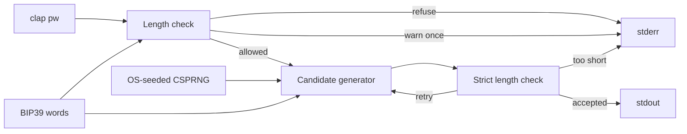

# Requirements

`belt pw [MIN_LENGTH]` prints one password followed by a newline. The password must be **strictly longer** than `MIN_LENGTH`: the default `16` requires at least 17 characters. An explicit non-negative integer replaces the default, even below 16. `belt pw --help` explains this distinction and shows the default.

Each password contains four independently drawn English BIP39 words; repeats are allowed. Exactly one to three word positions are uppercased and the rest stay lowercase. Each gap contains one character: at least one ASCII digit and at least one symbol from `&+.,/-=?@#^%`. All random decisions use a cryptographically secure generator.

| Requested length | Behaviour with the current list                                                                            |
| ---------------- | ---------------------------------------------------------------------------------------------------------- |
| `0–25`           | Generate without an entropy warning.                                                                       |
| `26–28`          | Warn once on stderr that the request significantly restricts password entropy, then proceed.               |
| `29` or more     | Explain the refusal on stderr and exit non-zero without generating a password. This includes `belt pw 32`. |

For each candidate at or below the requested length, report on stderr that it was too short and is being regenerated. Never include the rejected password in a diagnostic. On success, stdout contains only the accepted password; on failure it stays empty.

# Technical Design

### Command and generator

Follow the `Cli` / `Command` derive-and-dispatch pattern in `docs/getting-started/part-01.md`. Parse `Command::Pw { min_length: usize }` with a default of `16`. A bare `belt` prints top-level help successfully, preserving the existing no-argument Docker smoke run without generating a password.

Use `bip39::Language::English.word_list()` directly: the BIP32 references mean the same BIP39 dictionary, not a wallet mnemonic or checksum. For each candidate, draw four uniform word indices with replacement. Draw the uppercase count uniformly from `1..=3`, then select that many distinct positions uniformly. Choose uniformly among the six three-gap digit/symbol patterns containing both types; draw each joiner uniformly from its alphabet.

Use the locked `rand` 0.10.3 as a direct dependency with `std_rng`, `sys_rng` and `unbiased` enabled. Seed `StdRng` once per permitted invocation with `StdRng::try_from_rng(&mut SysRng)`. Pass it to `generate_candidate(rng: &mut impl rand::CryptoRng) -> String` for **every** draw and retry. If OS seeding fails, return an error rather than falling back to a weaker source.

### Runtime length policy

Count the dictionary words by length. Starting with one way to make length 3 (the joiners), convolve the histogram four times. Uppercasing English ASCII does not change length. Of `2048⁴` equally likely ordered word tuples, count those whose total length is **at or below** the requested value. Use `u64` integer comparisons: refuse if `100 × rejected > 95 × total`; otherwise warn if `100 × rejected > 70 × total`. Compute this once before seeding, with storage sized by the dictionary, not by the CLI argument.

The current list crosses 70% between `25` (63.79%) and `26` (77.14%), and 95% between `28` (93.78%) and `29` (97.43%). These numbers are regression expectations, not production constants.

### Files

- `src/main.rs`: replace the greeting with argument parsing, dispatch and exit handling.
- `src/pw.rs` (new): own candidate generation, length classification and the retry loop; keep unit tests alongside these functions.
- `Cargo.toml`, `Cargo.lock`: declare and lock the RNG dependency explicitly.
- `tests/pw_cli.rs` (new): exercise the binary and capture its streams separately.
- `README.md`, `AGENTS.md`: replace the scaffold-only description and document the command; edit the canonical guide, not the `CLAUDE.md` symlink.

# Testing

- Verify candidate structure: four dictionary members after case normalisation; one to three wholly uppercase positions; exactly three permitted joiners containing both types. Do not use statistical frequency assertions as evidence of security.
- Check histogram totals against `2048⁴` and classify `25`, `26`, `28`, `29`, `32` and `usize::MAX`. A refused request must not reach the generator.
- Exercise the retry loop with scripted candidates below, exactly at and above the requested length. Assert one diagnostic per rejection, no candidate leakage, and only the accepted result returned. Keep deterministic inputs test-only.
- Run the binary for the default, a shorter override, a warned request, refusal, malformed input and `pw --help`. Check status, stdout and stderr independently; allow retry notices on valid requests. Verify bare `belt` still exits successfully.
- Run the repository’s formatting check, locked Clippy with `-D warnings`, locked tests and locked release build.

# Delivery Steps

### ✓ Step 1: Generate secure four-word candidates

`src/pw.rs` can generate a complete candidate using only a cryptographically secure RNG.

- Add `rand` explicitly to `Cargo.toml` and update `Cargo.lock`.
- Implement the independent word draws, distinct uppercase positions and mixed joiner patterns against the crate’s English list.
- Test the word, case and separator invariants without relying on particular random outputs.

### ✓ Step 2: Enforce the runtime length policy

The password module derives its limits from the dictionary and returns only a candidate longer than the requested length.

- Calculate exact rejection counts once per request and classify it before obtaining OS entropy.
- Refuse, warn once or proceed as appropriate; seed the generator for permitted requests and emit a secret-free diagnostic for every retry.
- Verify both threshold crossings, very large inputs and equality-at-the-minimum retries with deterministic tests.

### ✓ Step 3: Expose `belt pw` with clean output streams

The binary exposes the documented command and can safely pipe a successful password to another program.

- Wire the optional positional argument, default, help and error handling into `src/main.rs`; retain a successful no-argument entrypoint.
- Write only the final password and newline to stdout. Cover help, generation, warnings and failures in `tests/pw_cli.rs`.
- Update `README.md` and `AGENTS.md`, then run the repository’s formatting, lint, test and release-build checks.
