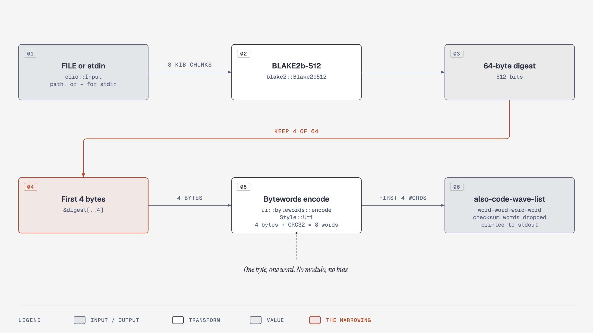
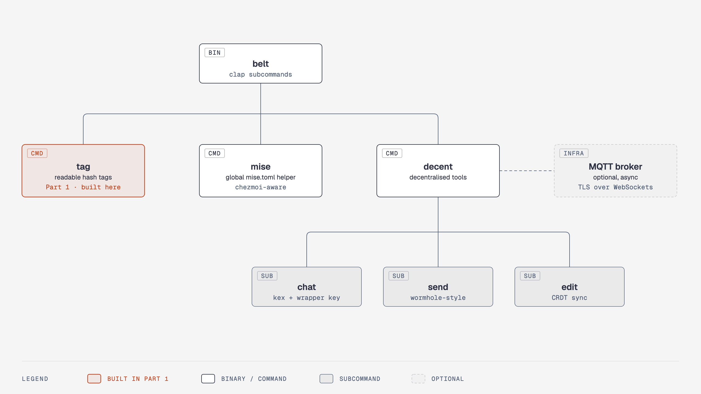

# belt, Part 1: a `tag` you can say out loud

A BLAKE2b-512 digest is 64 bytes. Written in hex it is 128 characters long, which is why nobody reads one over the phone, pastes one into a commit message, or remembers which of two builds was `3f9c…` and which was `3f8c…`.

`belt tag` fixes that by throwing most of the digest away. It hashes a file, keeps the first 4 bytes, and spells them as four short English words: `also-code-wave-list`. That is still 4.3 billion possible tags, which is plenty for telling two builds apart, and it fits in a sentence.

Right now the `belt` binary does one thing: `println!("Hello, world!")`. By the end of this part, you'll have a `belt tag [FILE]` subcommand that hashes a file or stdin, prints a four-word tag, has unit tests next to the code, and passes the same `fmt`, `clippy` and `test` gates that CI runs. Along the way you'll meet the handful of Rust ideas that have no direct Python or Ruby equivalent: `Result` and `?`, `Option`, exhaustive `match`, and modules you declare instead of discover.

## What you'll build

`belt tag Cargo.toml` prints something like `zone-fern-exit-bald`. `printf 'hello world' | belt tag -` prints exactly `also-code-wave-list`, every time, on every machine. Three unit tests pin that behaviour down. The code lives in two files, `src/main.rs` (argument parsing, about 40 lines) and `src/tag.rs` (hashing and encoding, about 60 lines including tests).

## Prerequisites

- A clone of the repo with `mise install` done, so `cargo --version` reports `1.99.1`. This part is written against **Rust 1.99.1** and **edition 2024**; the clippy lint it mentions later did not exist in older toolchains.
- Working knowledge of Python or Ruby. Where Rust does something the same way, this part says so and moves on.
- No Rust at all. Terms are defined the first time they appear.

## The repo, translated from Python and Ruby

Everything you need to know about the layout fits in one table. Cargo is pip, Bundler and Rake in one tool.

| You know this as                  | In this repo                | Notes                                                                                                                                                                                 |
| --------------------------------- | --------------------------- | ------------------------------------------------------------------------------------------------------------------------------------------------------------------------------------- |
| `pyproject.toml`, `Gemfile`       | `Cargo.toml`                | Declares dependencies with version ranges. You edit this.                                                                                                                             |
| `poetry.lock`, `Gemfile.lock`     | `Cargo.lock`                | Exact resolved versions. Cargo writes it; [commit it](https://doc.rust-lang.org/cargo/guide/cargo-toml-vs-cargo-lock.html). CI passes `--locked` so a stale lockfile fails the build. |
| package, gem                      | **crate**                   | `clap`, `blake2` and friends. Rust people say "crate" even when they mean "library".                                                                                                  |
| `import x`, `require 'x'`         | `use x::Thing;`             | Every crate in `Cargo.toml` is already linked. `use` only shortens a path so you can write `Parser` instead of `clap::Parser`.                                                        |
| `src/package/__init__.py`, `lib/` | `src/main.rs`               | The **crate root**. For a binary crate this is where `fn main` lives.                                                                                                                 |
| `pytest`, `rspec`                 | `cargo test`                | Tests live in the same file as the code they test.                                                                                                                                    |
| `ruff`, `black`, `rubocop`        | `cargo clippy`, `cargo fmt` | Clippy is the linter. CI runs it with `-D warnings`, so a warning is a failure.                                                                                                       |
| `python -m belt tag x`            | `cargo run -- tag x`        | The `--` separates cargo's arguments from `belt`'s, exactly as in `python -m`.                                                                                                        |

Two things in this repo are not standard Cargo and will surprise you on the first build.

> [!HEADS-UP]
> `target` is a symlink into `~/Library/Caches/mbx/`, and every `cargo` command ends with a line like `mbx[cache]: 0 hits, 0 misses, 173 not looked up`. That is `mr-boxington`, a build cache that `mise.toml` wires in as a wrapper around `cargo`. The binary still lands at `target/debug/belt`. You can ignore the trailer; it is not an error.

The dependencies are already declared. Open `Cargo.toml` and look at the `clap` entry: the `derive` feature is the one that lets you describe a command line as a struct with annotations, which is how this whole part works. `clio` turns a filename argument into an open file. `blake2` hashes. `ur` has the `bytewords` module that turns bytes into words. `bip39` is in there too, as a fallback wordlist you will not need today.

With the map in hand, the next step is the smallest change that turns "Hello, world!" into a program with a subcommand.

## A `tag` subcommand that parses before it does anything

**Argument parsing** in Rust with [`clap`](https://docs.rs/clap/4.6.7/clap/_derive/index.html) looks like a Python dataclass or a Ruby `Struct` with decorators: you write a plain struct, add `#[derive(Parser)]`, and clap generates the parser, the `--help` text and the error messages at compile time. The `#[derive(...)]` line is a **derive macro**, code that writes code during compilation. You will see the same shape on `#[derive(Debug)]`, `#[derive(Clone)]` and so on.

Replace the whole of `src/main.rs` with this. Read the `enum` first; it is the part that has no Python equivalent.

```rust
mod tag;

use clap::{Parser, Subcommand};
use clio::Input;

/// A CLI toolbelt.
#[derive(Parser)]
#[command(name = "belt", version, about, long_about = None)]
#[command(propagate_version = true)]
struct Cli {
    #[command(subcommand)]
    command: Command,
}

#[derive(Subcommand)]
enum Command {
    /// Print a readable tag derived from the BLAKE2b hash of a file.
    Tag {
        /// File to hash. Use `-` to read standard input.
        #[arg(value_parser)]
        input: Option<Input>,
    },
}
```

Three things to notice.

**`mod tag;` is a declaration, not an import.** Python finds `tag.py` by scanning the directory. Rust does not scan. The line `mod tag;` tells the compiler to go and look for [`src/tag.rs` (or `src/tag/mod.rs`)](https://doc.rust-lang.org/book/ch07-02-defining-modules-to-control-scope-and-privacy.html#modules-cheat-sheet) and compile it as part of this crate. Forget the line and the file is not part of the program. You will write that file in the next section.

**`enum Command` carries data.** A Rust `enum` is not a list of named integers. Each variant can hold fields, so `Command::Tag { input }` is a variant with one field. clap's `#[derive(Subcommand)]` reads the variant names as subcommand names (`Tag` becomes `tag`) and the doc comments (`///`) as help text. When you add `belt mise` later, it is one more variant.

**`Option<Input>` is how Rust spells "maybe".** There is no `None`/`nil` that can sneak into any variable. A value that might be absent has type `Option<T>`, and the compiler makes you handle both cases. Here it means the `FILE` argument is optional on the command line. [`clio::Input`](https://docs.rs/clio/0.3.5/clio/struct.Input.html) is a type that clap can parse directly: give it a path and it opens the file, give it `-` and it hands you stdin. Opening happens _during argument parsing_, so clap reports a missing file, in clap's house style, before any of your code runs.

> [!ASIDE]
> `#[command(name = "belt", ...)]` is there because the package is called `belt-cli` in `Cargo.toml` but the binary is `belt`. Without it, `belt --version` prints `belt-cli 0.0.0-pre.0`. With it, `belt 0.0.0-pre.0`. `propagate_version` makes `belt tag --version` work too.

Now the `main` function. Here is the tempting version, the one that treats `tag::tag_for_reader` like a Python function that either returns or raises:

```rust
fn main() {
    let cli = Cli::parse();
    match cli.command {
        Command::Tag { input: Some(mut input) } => {
            let readable_tag = tag::tag_for_reader(&mut input);
            println!("{readable_tag}");
        }
        Command::Tag { input: None } => {}
    }
}
```

It will not compile, and the reason is the single most important idea in this part. Rust has no exceptions. A function that can fail returns a [`Result<T, E>`](https://doc.rust-lang.org/book/ch09-02-recoverable-errors-with-result.html), a two-variant enum that is either `Ok(value)` or `Err(error)`. `tag_for_reader` returns `Result<String, io::Error>`, so `readable_tag` above is a `Result`, not a `String`, and `println!` will refuse it. You cannot forget to handle a failure, because the success value is locked inside the `Result` until you unwrap it.

The idiomatic way to unlock it is the [`?` operator](https://doc.rust-lang.org/book/ch09-02-recoverable-errors-with-result.html#the--operator-shortcut): `tag::tag_for_reader(&mut input)?` means "if this is `Ok`, give me the value; if it is `Err`, return that error from the current function right now". It is `raise`, but explicit, one character, and only allowed inside a function that itself returns a `Result`. So `main` has to return one too. Replace the stub above with:

```rust
fn main() -> Result<(), Box<dyn std::error::Error>> {
    let cli = Cli::parse();

    match cli.command {
        Command::Tag {
            input: Some(mut input),
        } => {
            let readable_tag = tag::tag_for_reader(&mut input)?;
            println!("{readable_tag}");
        }
        Command::Tag { input: None } => {
            // TODO: random tags (Part 2). Fail loudly rather than block on a tty.
            return Err(
                "random tags are not implemented yet; pass a FILE, or `-` for stdin".into(),
            );
        }
    }

    Ok(())
}
```

`Box<dyn std::error::Error>` reads as "any error type, boxed up". It is the Rust equivalent of `except Exception` and it is fine for `main`. If `main` returns `Err`, the process prints the error and exits with status 1.

The `match` is Python's `match` statement with teeth: it is [exhaustive](https://doc.rust-lang.org/book/ch06-02-match.html#matches-are-exhaustive). Delete the `None` arm and the compiler rejects the build, naming the case you forgot. That `None` arm is the honest state of the project: the roadmap says a bare `belt tag` should print a _random_ tag, and random bytes need a crate this repo does not have yet. Failing with a message beats silently reading from a terminal that never sends end-of-file.

`&mut input` is the one piece of **ownership** syntax in this part. Rust gives [each value exactly one owner](https://doc.rust-lang.org/book/ch04-01-what-is-ownership.html#ownership-rules), and passing `input` by value would hand it over for good. `&mut input` lends it instead: `tag_for_reader` may read from it, and `main` still owns it afterwards. The `mut` in `Some(mut input)` is needed because reading from a file advances its position, which counts as mutation.

That is the whole command-line surface. Next: the function `main` is lending that file to.

## Hashing a file 8 KiB at a time

Create `src/tag.rs`. The first half is a hashing loop that would look the same in any language; the Rust-specific parts are the types.

```rust
//! Readable tags: a BLAKE2b-512 digest squeezed into four Bytewords.

use std::io::{self, Read};

use blake2::{Blake2b512, Digest};
use ur::bytewords::{Style, encode};

/// How many words make up a tag. One Byteword encodes one byte.
const WORD_COUNT: usize = 4;

/// How many bytes to pull from the reader per hasher update.
const READ_CHUNK_BYTES: usize = 8192;

/// Hash everything `reader` yields and return a `word-word-word-word` tag.
pub fn tag_for_reader(reader: &mut impl Read) -> io::Result<String> {
    let mut hasher = Blake2b512::new();
    let mut chunk = [0u8; READ_CHUNK_BYTES];

    loop {
        let bytes_read = reader.read(&mut chunk)?;
        if bytes_read == 0 {
            break;
        }
        hasher.update(&chunk[..bytes_read]);
    }

    let digest = hasher.finalize();
    Ok(words_for_bytes(&digest[..WORD_COUNT]))
}
```

`reader: &mut impl Read` says "a mutable borrow of anything that implements the `Read` trait". A **trait** is an interface, roughly a Ruby module you `include` or a Python protocol, except the compiler checks it. `clio::Input` implements `Read`, so does `std::fs::File`, and so does `&[u8]`, a byte slice. That last one is what makes the tests at the end of this part trivial: you hand the function a string's bytes and never touch the filesystem.

`[0u8; READ_CHUNK_BYTES]` is a fixed-size array of 8192 zero bytes, allocated on the stack. `read` fills as much of it as it can and returns how many bytes it wrote. `&chunk[..bytes_read]` is a **slice**, a view of the first `bytes_read` elements with no copy. Feeding the hasher a slice rather than the whole array is the difference between a correct hash and one that includes 8000 bytes of leftover zeros from the previous iteration.

`Blake2b512` is the 64-byte flavour of BLAKE2; [RFC 7693](https://www.rfc-editor.org/rfc/rfc7693) allows any digest length from 1 to 64 bytes, and the [`blake2` crate](https://docs.rs/blake2/0.11.0/blake2/) exposes the common ones as type aliases. `new`, `update` and `finalize` come from the `Digest` trait, which is why it is in the `use` line. `finalize` consumes the hasher: after that line, `hasher` no longer exists, and the compiler says so if you try to reuse it.

What happens on input that is not a file? Give `tag_for_reader` an empty reader and the loop body never runs, `finalize` returns the digest of zero bytes, and you get a valid tag: `keys-item-also-yell`, the same on every machine. A directory never gets this far because clio fails to open it during argument parsing, and clap prints `Invalid value for [INPUT]: Could not open "src": Is a directory (os error 21)`. Stdin with no pipe attached makes `read` block until you type something and press Ctrl-D, which is ordinary Unix behaviour and the reason the no-argument case fails loudly instead of defaulting to `-`.

That is 64 bytes in a `digest`. Next: turning four of them into words.

## From 64 bytes to four words

The whole encoding step is five lines, and the diagram below is the thing to look at first: the width of the arrows is the point. Everything to the right of the hasher is narrowing.



**Bytewords** is a scheme from Blockchain Commons that maps [each of the 256 possible byte values to its own four-letter English word](https://github.com/BlockchainCommons/Research/blob/master/papers/bcr-2020-012-bytewords.md): `0x00` is `able`, `0x01` is `acid`, and so on. One byte, one word. There is no bit-slicing, no modulo, and no bias to reason about. The [`ur` crate's `encode`](https://docs.rs/ur/0.5.2/ur/bytewords/fn.encode.html) does the mapping and, as the spec requires, appends a CRC32 checksum, so four bytes in gives eight words out. `belt tag` keeps the first four and drops the checksum words. Add this below `tag_for_reader`:

```rust
/// Encode `bytes` as dash-separated Bytewords, dropping the four checksum words.
fn words_for_bytes(bytes: &[u8]) -> String {
    encode(bytes, Style::Uri)
        .split('-')
        .take(bytes.len())
        .collect::<Vec<&str>>()
        .join("-")
}
```

If you have written a Python generator chain or a Ruby `each_slice(...).map(...).join`, this reads the same way. `Style::Uri` picks the dash-separated form. `split` produces an iterator over the eight words, `take` keeps the first `bytes.len()` of them, `collect` gathers them into a `Vec<&str>`, and `join` glues them with dashes. The one new wrinkle is `::<Vec<&str>>`, the **turbofish**: `collect` can build many container types, so you tell it which one.

> [!PREDICT]
> `encode(&[0x02, 0x1c, 0xed, 0x87], Style::Uri)` returns `also-code-wave-list-atom-kiwi-tomb-obey`. Those four bytes are the start of the BLAKE2b-512 digest of `hello world`. What will `belt tag` print for that input?

> [!DESIGN-NOTE]
> **Why Bytewords, and why four of them?**
>
> The obvious alternative is the [BIP-39 wordlist](https://github.com/bitcoin/bips/blob/master/bip-0039.mediawiki), 2048 words of three to eight letters, designed so the first four letters of any word are unambiguous. It packs 11 bits per word, so three BIP-39 words carry 33 bits where four Bytewords carry 32. The cost is that 11 does not divide into bytes: you end up slicing bits across byte boundaries, or taking two bytes per word and reducing them modulo 2048, and either way the encoding has arithmetic in it that a reader has to check. Bytewords has none. Its words are also uniformly four letters with [unique first-and-last letter pairs](https://github.com/BlockchainCommons/Research/blob/master/papers/bcr-2020-012-bytewords.md), which is what makes `Style::Minimal` (two letters per byte) possible later if a tag ever needs to be as short as hex. So the rule for `belt` is: Bytewords, unless there is a compelling reason to prefer BIP-39. The `bip39` crate stays in `Cargo.toml` so that if such a reason turns up, say a need to interoperate with a tool that only speaks BIP-39, the swap is a one-function change in `words_for_bytes`.
>
> Four words is a judgement call. Four bytes is 32 bits, about 4.3 billion tags. By the birthday bound, the point at which two random picks from a set are more likely than not to have collided, you would expect the first accidental duplicate after roughly 77,000 distinct files. For version specifiers on one person's projects that is more than enough, and `WORD_COUNT` is a constant so the call is one line to revisit.
>
> Dropping the checksum words is also a trade. The checksum would let `belt` detect a mistyped tag; keeping it would double the length. A `--verify` flag that re-encodes and compares is a reasonable future addition and is one of the exercises below.

The function is done. Next: proving it, in the same file.

## Tests that live next to the code

Rust puts unit tests in the file they test, inside a module that only exists when you run `cargo test`. Paste this at the bottom of `src/tag.rs`.

```rust
#[cfg(test)]
mod tests {
    use super::*;

    #[test]
    fn hello_world_has_a_known_tag() {
        let tag = tag_for_reader(&mut "hello world".as_bytes()).unwrap();
        assert_eq!(tag, "also-code-wave-list");
    }

    #[test]
    fn empty_input_still_gets_a_tag() {
        let tag = tag_for_reader(&mut "".as_bytes()).unwrap();
        assert_eq!(tag.split('-').count(), WORD_COUNT);
    }
}
```

[`#[cfg(test)]`](https://doc.rust-lang.org/book/ch11-03-test-organization.html#the-tests-module-and-cfgtest) means the module is compiled only for `cargo test`, so none of this ends up in the release binary. [`#[test]`](https://doc.rust-lang.org/book/ch11-01-writing-tests.html#structuring-test-functions) marks a function as a test. `use super::*;` pulls everything from the enclosing module into scope, private functions included, which is why a test here can see `WORD_COUNT` and `words_for_bytes` without making them `pub`.

`"hello world".as_bytes()` gives a `&[u8]`, and a `&mut &[u8]` is a reader: reading from it advances the slice. No temp files, no fixtures directory. `.unwrap()` is the test-only way to say "this `Result` had better be `Ok`, and if it is not, fail the test with the error". You will see `unwrap` in examples all over the internet; in `main` you want `?`, in tests `unwrap` is fine.

Now the third test, which is yours to write. You have seen how a test calls `tag_for_reader` on a string and compares with `assert_eq!`. Write `one_byte_changes_the_tag`: tag the bytes of `belt` and the bytes of `bolt`, and assert they differ. The macro you want is `assert_ne!`, which is `assert_eq!` with the opposite expectation. Then run the Checkpoint.

## Checkpoint

> [!PREDICT]
> Before you run anything: two of the five commands below print a tag. One of them prints `keys-item-also-yell`. Which one, and what else would produce that exact tag?

**Run this to verify your work so far:**

```bash
cargo fmt --all -- --check
cargo clippy --locked --all-targets --all-features -- -D warnings
cargo test --locked --all-features
printf 'hello world' | cargo run --quiet -- tag -
cargo run --quiet -- tag /dev/null
```

Expected output, trimmed of the `Compiling` lines and the `mbx[cache]` trailers:

```text
running 3 tests
test tag::tests::empty_input_still_gets_a_tag ... ok
test tag::tests::hello_world_has_a_known_tag ... ok
test tag::tests::one_byte_changes_the_tag ... ok

test result: ok. 3 passed; 0 failed; 0 ignored; 0 measured; 0 filtered out; finished in 0.00s
also-code-wave-list
keys-item-also-yell
```

The three test lines may come out in a different order; `cargo test` runs tests on several threads. `/dev/null` and `printf '' | belt tag -` give the same tag because both are zero bytes long, and a hash function does not know or care where its zero bytes came from.

`cargo fmt` and `cargo clippy` should both pass silently. Clippy is the one to watch over time: its lints change with the toolchain, and CI runs the pinned 1.99.1 with `-D warnings`, so a suggestion that is advisory on your machine is a build failure in CI if the versions drift. An earlier draft of `words_for_bytes` used `chunks_exact(2)` and 1.99 rejected it with [`chunks_exact_to_as_chunks`](https://rust-lang.github.io/rust-clippy/rust-1.99.0/index.html#chunks_exact_to_as_chunks). Run clippy locally before you push.

**Likely errors:**

- If you see `error[E0433]: cannot find module or crate 'tag' in this scope`, you skipped the `mod tag;` line at the top of `src/main.rs`. The compiler's own hint says exactly that: `use 'mod tag' in this file to declare the module`.
- If you see `error[E0369]: binary operation '==' cannot be applied to type 'Result<usize, std::io::Error>'`, you dropped the `?` after `reader.read(&mut chunk)`. `bytes_read` is a `Result` and cannot be compared with `0` until you unwrap it.
- If you see `error[E0004]: non-exhaustive patterns: 'Command::Tag { input: None }' not covered`, you left out the `None` arm of the `match`. Rust will not let you forget a case.
- If `cargo fmt --all -- --check` prints a diff, run `cargo fmt --all` and look at what it changed. The `match` arm with `Some(mut input)` is the usual culprit; rustfmt breaks it over three lines.
- If `cargo run -- tag` with no file prints `Error: "random tags are not implemented yet; ..."` with the quotes, that is working as intended. `main` returning `Err` prints the error in its debug form, hence the quotes. A friendlier error type is a later part's job.
- If you see `error: unexpected argument 'Cargo.lock' found` you passed two files. `belt tag` takes one. clap generated that message, and the `Usage: belt tag [INPUT]` line under it, from the struct you wrote.

## What's next



`belt tag` is the smallest leaf on that tree, which is why it went first: it exercised clap, clio, a hashing crate and the test harness without any networking. The next part fills in the `None` arm with real random bytes and then starts on `belt mise`, which has to read and rewrite a TOML file that `chezmoi` may own. The question that part answers is the one `belt tag` dodged: what does error handling look like when there are five ways to fail and the user needs to know which one happened? `belt decent` comes after that. Its file-transfer piece is modelled on [Magic Wormhole](https://magic-wormhole.readthedocs.io/en/latest/welcome.html#design), which uses a password-authenticated key exchange (SPAKE2) so that a short, speakable code is enough to set up an encrypted channel. Four Bytewords is a short, speakable code. That is not a coincidence.

Before you try the exercises: in two sentences, explain to a sceptical colleague why `tag_for_reader` takes `&mut impl Read` rather than a file path. Your answer should mention the tests.

## Exercises

- [ ] Make a bare `belt tag` print a random tag. Run `cargo add rand`, then generate 4 random bytes with `rand::random::<[u8; 4]>()` and pass them to `words_for_bytes`. You will need to make that function `pub`. Check that `cargo add` also changed `Cargo.lock`, and commit both files.
- [ ] Add a `--words N` flag to `belt tag` that controls how many Bytewords are printed, clamped to 1 through 8. Use `#[arg(long, default_value_t = 4)]` and thread the value through to `words_for_bytes` in place of `WORD_COUNT`. Add a test for `N = 1`.
- [ ] Add `--minimal`, which prints the tag in `Style::Minimal` (two letters per byte, no separators) so `hello world` becomes `aocewelt`. `split('-')` no longer applies; slice the string instead.
- [ ] Add `belt tag --verify TAG FILE`, which re-tags the file and exits 0 if the tag matches and 1 with a message if not. Then read `ur::bytewords::decode` and work out what it would take to detect a mistyped word without hashing the file at all.

## Sources

Primary documentation:

1. [clap derive reference](https://docs.rs/clap/4.6.7/clap/_derive/index.html) — the `#[command]` and `#[arg]` attributes used in `src/main.rs`, for the exact clap version pinned in `Cargo.lock`.
2. [clap derive tutorial](https://docs.rs/clap/4.6.7/clap/_derive/_tutorial/index.html) — the subcommand pattern (`#[command(subcommand)]` plus `#[derive(Subcommand)]`) that `Command` follows.
3. [`clio::Input`](https://docs.rs/clio/0.3.5/clio/struct.Input.html) — opens a path or stdin (`-`) during clap parsing; implements `Read`.
4. [`blake2` crate](https://docs.rs/blake2/0.11.0/blake2/) — `Blake2b512`, and the `Digest` trait that supplies `new`, `update` and `finalize`.
5. [`ur::bytewords::encode`](https://docs.rs/ur/0.5.2/ur/bytewords/fn.encode.html) — the three `Style`s, with worked examples including `able-tied-also-webs-lung` for a single zero byte.
6. [Cargo.toml vs Cargo.lock](https://doc.rust-lang.org/cargo/guide/cargo-toml-vs-cargo-lock.html) — why the lockfile is committed and what `--locked` guards.

Specifications:

7. [RFC 7693: BLAKE2](https://www.rfc-editor.org/rfc/rfc7693) — digest length is 1 to 64 bytes; `Blake2b512` is the 64-byte case.
8. [BCR-2020-012: Bytewords](https://github.com/BlockchainCommons/Research/blob/master/papers/bcr-2020-012-bytewords.md) — 256 four-letter words, unique first and last letters, four-word CRC32 checksum, three encoding styles.
9. [BIP-39](https://github.com/bitcoin/bips/blob/master/bip-0039.mediawiki) — the 2048-word, 11-bits-per-word alternative discussed in the design note.

The Rust Book, for the language concepts introduced here:

10. [Modules cheat sheet](https://doc.rust-lang.org/book/ch07-02-defining-modules-to-control-scope-and-privacy.html#modules-cheat-sheet) — where `mod tag;` makes the compiler look.
11. [Recoverable errors with `Result`](https://doc.rust-lang.org/book/ch09-02-recoverable-errors-with-result.html) and [the `?` operator](https://doc.rust-lang.org/book/ch09-02-recoverable-errors-with-result.html#the--operator-shortcut).
12. [Matches are exhaustive](https://doc.rust-lang.org/book/ch06-02-match.html#matches-are-exhaustive) — why the `None` arm cannot be omitted.
13. [Ownership rules](https://doc.rust-lang.org/book/ch04-01-what-is-ownership.html#ownership-rules) — the one-owner rule behind `&mut input`.
14. [Structuring test functions](https://doc.rust-lang.org/book/ch11-01-writing-tests.html#structuring-test-functions) and [the `tests` module and `#[cfg(test)]`](https://doc.rust-lang.org/book/ch11-03-test-organization.html#the-tests-module-and-cfgtest).

Other:

15. [clippy `chunks_exact_to_as_chunks`](https://rust-lang.github.io/rust-clippy/rust-1.99.0/index.html#chunks_exact_to_as_chunks) — the 1.99 lint mentioned in the Checkpoint.
16. [Magic Wormhole: design](https://magic-wormhole.readthedocs.io/en/latest/welcome.html#design) — the PAKE-based handshake that `belt decent` will borrow from.
