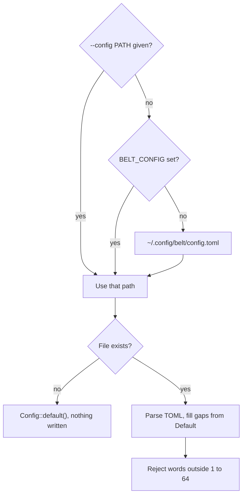

# belt, Part 2: a config file that is also a struct

The Python version of `belt` kept its settings in `~/.config/belt/config.yaml` and read them with a 37-line function made of `.get()` calls, one per key, each with its own hand-written fallback. Two sections, five keys, 37 lines. A third section would have added about a dozen more.

The Rust version is one struct per section, with the defaults written once and the file format derived from the field names. The parsing, the fallbacks, and the unknown-key check come from a derive macro, the code generator you met in Part 1. A separate crate answers the question of where the file lives on macOS versus Linux, and it has thought about that harder than either of us wants to.

> [!RECALL]
> Before you continue: `tag_for_reader` takes `&mut impl Read`, not a file path. What does that buy the tests, and what does `main` have to do because of it?

By the end of this part, you'll have `belt config path`, `belt config init`, a `--config PATH` flag that `BELT_CONFIG` can also set, and a `belt tag` that reads how many words to print from `~/.config/belt/config.toml`. A bad file fails with its line and column, a missing file means defaults, and three new tests pin all of that down.

## What you'll build

`belt config path` prints `/Users/you/.config/belt/config.toml` on macOS and `/home/you/.config/belt/config.toml` on Linux. `belt config init` writes that file with default values and refuses to overwrite it without `--force`. With `words = 6` in the file, `printf 'hello world' | belt tag -` prints `also-code-wave-list-nail-diet`: the same four words as Part 1, then two more. The code is a new `src/config.rs` of about 90 lines plus 45 lines of tests, about 60 new lines in `src/main.rs`, and a one-argument change to `tag_for_reader`.

## Prerequisites

- Part 1 finished: `cargo test` reports three passing tests and `belt tag` works.
- The same toolchain, **Rust 1.99.0**, edition 2024. Every version number in this part comes from the `Cargo.lock` that `cargo add` writes on that toolchain today.
- Nothing else. Serde, the serialisation framework this part leans on, is introduced from zero.

## Five crates that read config, and the one that writes it back

Rust has no standard configuration library, so the first job is to choose one. The candidates split by one question: does the crate know where the file _is_, or only what is _in_ it?

| Crate                                                                  | Formats                                                                  | Finds the path | Writes it back | Shape                                                                                                                                                                                          |
| ---------------------------------------------------------------------- | ------------------------------------------------------------------------ | -------------- | -------------- | ---------------------------------------------------------------------------------------------------------------------------------------------------------------------------------------------- |
| [`config`](https://docs.rs/config/0.15.27/config/) 0.15.27             | TOML, JSON, YAML, JSON5, RON, INI                                        | No             | No             | A builder that layers files, environment variables and overrides, then deserialises the merged result. Can watch files for changes.                                                            |
| [`figment`](https://docs.rs/figment/0.10.19/figment/#overview) 0.10.19 | TOML, JSON, YAML, env                                                    | No             | No             | Same layering idea, with [`merge` and `join`](https://docs.rs/figment/0.10.19/figment/#overview) for "later wins" versus "first wins", and errors that say which source a bad value came from. |
| [`confy`](https://docs.rs/confy/2.0.0/confy/) 2.0.0                    | One of TOML, YAML or RON (Rusty Object Notation), chosen at compile time | Yes            | Yes            | `load` and `store`, each one call. A missing file is created from your type's `Default`.                                                                                                       |
| `etcetera` + `toml` by hand                                            | Whatever you wire up                                                     | Yes            | Yes            | About 30 lines of your own: find the directory, `create_dir_all`, read, parse, write. Full control, and you own every edge case.                                                               |
| `toml`, `serde_yaml_ng`, `json5` alone                                 | One each                                                                 | No             | Yes            | Format crates. They turn text into structs and back and know nothing about files.                                                                                                              |

`config` and `figment` are the serious choices when settings come from several places and the file is one of them. Neither has a save operation; if `belt init` is ever going to write a file, that code is yours either way. `confy` is the only crate in the table where reading, writing, and locating the file are one linked API. The price is that it supports [exactly one format per build](https://docs.rs/confy/2.0.0/confy/#features), picked by a cargo feature. That price is acceptable here, and the next design note says why TOML is the format to pick.

> [!DESIGN-NOTE]
> **TOML, YAML, or JSONC?**
>
> **TOML** is what Cargo, `mise.toml` and most of the Rust tooling around you already speak. The [`toml` crate](https://docs.rs/toml/1.1.8/toml/) tracks spec 1.1.0, and its parse errors carry a line, a column, and a caret, as the examples later in this part show. Comments are part of the format. The version `confy` pulls in is `toml 0.9.12`; the current standalone release is 1.1.8. Both parse the same files.
>
> **YAML** is what the Python `belt` used, and the catch is the crate. `serde_yaml`, the one everyone depended on, is published as [`0.9.34+deprecated`](https://docs.rs/crate/serde_yaml/latest) and its README says [_"This project is no longer maintained"_](https://github.com/dtolnay/serde-yaml); the last release was 25 March 2024. `confy`'s `yaml_conf` feature [depends on that crate](https://docs.rs/confy/2.0.0/confy/#features). The forks are [`serde_yaml_ng`](https://github.com/acatton/serde-yaml-ng), whose author describes maintaining it "for myself, and for the rust ecosystem as a whole", and `serde_norway`. Both work; neither has the years of scrutiny the original had. YAML also has the [`yes`/`no`/`on`/`off` booleans](https://yaml.org/type/bool.html) from the 1.1 spec, which is why a country code of `NO` in an unquoted YAML file is a classic bug. TOML has none of that.
>
> **JSONC** (JSON with comments), meaning JSON plus `//` and `/* */` comments and trailing commas, has no crate of that name. It has three near neighbours. [`json5`](https://github.com/callum-oakley/json5-rs) 1.3.1 parses a superset: comments, trailing commas, unquoted keys, single-quoted strings. Any JSONC file is valid JSON5. [`serde_json_lenient`](https://github.com/google/serde_json_lenient) 0.2.4 is Google's fork of `serde_json` with comments and trailing commas switched on, each feature individually. [`jsonc-parser`](https://github.com/dprint/jsonc-parser) 0.34 is the one to use if you need to _edit_ a JSONC file and keep its comments. None of these is wired into `confy`, so JSONC would mean the hand-rolled row of the table.
>
> One thing to know about all three formats before you pick: every serde-based writer, `toml::to_string_pretty` included, serialises your struct, and nothing else. Comments in a hand-edited file do not survive a write. That is fine for `belt config init`, which creates the file. It is also the reason a later part gives `belt mise` the format-preserving `toml_edit` crate instead of plain `toml`. Choosing TOML keeps that door open, because `toml_edit` lives in the [same `toml-rs` repository](https://github.com/toml-rs/toml) as `toml`.

So the choice is `confy` with its default `toml_conf` feature, a `Config` struct, and `~/.config/belt/config.toml`. Next: the struct.

## A `Config` struct that is also the file

Add the two crates. `confy` brings `toml` with it; `serde` is the framework that both of them use to turn text into structs, and `derive` is the feature that lets you ask for that with one attribute.

```bash
cargo add confy serde --features serde/derive
```

`Cargo.toml` gains `confy = "2.0.0"` and `serde = { version = "1.0.229", features = ["derive"] }`, and `Cargo.lock` gains ten packages, among them `toml 0.9.12` and `etcetera 0.10.0`. Commit both files, as in Part 1.

> [!HEADS-UP]
> In this repo you would get away with forgetting `features = ["derive"]`: `tera` is one of several crates in `Cargo.toml` that already switch it on, and Cargo [unifies features](https://doc.rust-lang.org/cargo/reference/features.html#feature-unification) across the whole build. In a fresh project the same omission fails with `cannot find derive macro 'Deserialize'`. Write the feature down anyway; the day someone removes `tera` is the wrong day to find out.

Now create `src/config.rs`. Read the attributes above `Config` first; they are the whole trick.

```rust
//! Configuration: a `Config` struct that is also the on-disk file format.

use std::error::Error;
use std::path::{Path, PathBuf};

use confy::ConfyError;
use serde::{Deserialize, Serialize};

use crate::tag::DEFAULT_WORD_COUNT;

/// The directory name under `~/.config/`.
const APP_NAME: &str = "belt";

/// The file name inside that directory, minus the `.toml` extension.
const CONFIG_NAME: &str = "config";

/// The most Bytewords a tag can hold: BLAKE2b-512 yields 64 bytes.
pub const MAX_TAG_WORDS: usize = 64;

/// Everything `belt` reads from `config.toml`.
#[derive(Debug, Clone, Default, PartialEq, Serialize, Deserialize)]
#[serde(default, deny_unknown_fields)]
pub struct Config {
    pub tag: TagConfig,
    pub decent: DecentConfig,
}
```

**Serde** is a framework, not a format. `Serialize` and `Deserialize` are traits that describe how to walk a value's fields; the `toml` crate supplies the other half, how to write those fields as TOML text and read them back. Deriving the two traits is the same move as `#[derive(Parser)]` in Part 1: a macro reads the struct definition and writes the code. A `Config` with fields `tag` and `decent` becomes a TOML document with tables `[tag]` and `[decent]`, and the field names are the key names. There is no schema to keep in sync, because the struct _is_ the schema.

The two `#[serde(...)]` attributes change what the macro writes:

- [`default`](https://serde.rs/container-attrs.html#default) says that any field missing from the file is filled in from the struct's `Default`. Without it, a file containing only `[tag]` is an error, and you will see that error in a moment.
- [`deny_unknown_fields`](https://serde.rs/container-attrs.html#deny_unknown_fields) turns a key the struct does not have into an error. Serde's own default is to ignore unknown keys silently. That is the right choice for a web API and the wrong one for a config file, where an unknown key is usually a typo you want to hear about.

`Default` in the derive list is required twice over: `#[serde(default)]` needs it, and so does `confy::load`, whose signature is [`T: Serialize + DeserializeOwned + Default`](https://docs.rs/confy/2.0.0/confy/fn.load.html). Forget it and the compiler reports the first of those, pointing at the `Deserialize` derive.

Now the two sections. `TagConfig` cannot derive `Default`, because the default number of words is four, not zero.

```rust
/// The `[tag]` table.
#[derive(Debug, Clone, PartialEq, Serialize, Deserialize)]
#[serde(default, deny_unknown_fields)]
pub struct TagConfig {
    /// How many Bytewords `belt tag` prints. 1 to 64.
    pub words: usize,
}

impl Default for TagConfig {
    fn default() -> Self {
        Self {
            words: DEFAULT_WORD_COUNT,
        }
    }
}

/// The `[decent]` table.
#[derive(Debug, Clone, Default, PartialEq, Serialize, Deserialize)]
#[serde(default, deny_unknown_fields)]
pub struct DecentConfig {
    /// MQTT broker URL. Absent means "not configured yet".
    pub broker: Option<String>,
}
```

`impl Default for TagConfig` is a hand-written **trait implementation**, the thing `#[derive(Default)]` would have generated if zero had been the right answer. It is the first `impl` block in this project. The shape, `impl Trait for Type { fn method(...) }`, is the same for every trait, and you will write a bigger one in the next part. `DEFAULT_WORD_COUNT` comes from `src/tag.rs`, so the default lives next to the code that uses it; `crate::` at the front of the path means "start from the crate root", the Rust equivalent of an absolute import.

`Option<String>` is how a nested table says "this key may be absent". TOML has no `null`, so when `broker` is `None` the key is left out of the file entirely, and the `[decent]` header is written on its own. You will see that header in the Checkpoint.

`src/tag.rs` needs three small edits so the word count comes from outside. Replace the constant and the signature:

```rust
/// How many words a tag has unless the config file says otherwise.
pub const DEFAULT_WORD_COUNT: usize = 4;

/// Hash everything `reader` yields and return a tag of `word_count` Bytewords.
pub fn tag_for_reader(reader: &mut impl Read, word_count: usize) -> io::Result<String> {
```

and inside it, `Ok(words_for_bytes(&digest[..word_count]))`. The three tests in that file each gain a second argument, `DEFAULT_WORD_COUNT`, and `empty_input_still_gets_a_tag` compares against the same constant. Nothing about the hashing changed.

Here is the version of `Config` that looks right and is not. Leave off `#[serde(default)]`, write a file containing only `[tag]` and `words = 6`, and `belt tag` says:

```text
error: could not read six.toml: Bad TOML data: TOML parse error at line 1, column 1
  |
1 | [tag]
  | ^
missing field `decent`
```

A config file you have to pad with empty `[decent]` headers is a config file nobody edits by hand. With `#[serde(default)]` on every struct, that file parses, `decent` is `DecentConfig::default()`, and the six-word tag prints. Put the attribute on each of the three structs, not only `Config`: `default` on the outer struct only fills in a _missing_ `[tag]` table, not a `words` key missing from a `[tag]` table that is present.

That completes the type. Next: where the file is.

## Where the file lives, on every OS

`confy` does not ask you for a path. It asks for an application name and a file name and derives the path from the operating system's conventions, through the [`etcetera`](https://docs.rs/etcetera/0.11.0/etcetera/#native-strategy) crate. Below the structs, add this `impl` block:

```rust
impl Config {
    /// Where `belt` looks when no `--config` or `BELT_CONFIG` is given.
    pub fn default_path() -> Result<PathBuf, ConfyError> {
        confy::get_configuration_file_path(APP_NAME, CONFIG_NAME)
    }
}
```

On this machine that returns `/Users/syn/.config/belt/config.toml`. The reason it is `~/.config` and not `~/Library/Application Support` is a deliberate choice inside `confy`. Its default strategy, [`ConfigStrategy::App`](https://docs.rs/confy/2.0.0/src/confy/lib.rs.html#577-605), calls `etcetera`'s `choose_app_strategy`, which [uses the XDG layout on both Linux and macOS](https://docs.rs/etcetera/0.11.0/etcetera/#native-strategy). XDG (the freedesktop.org base-directory layout) means `$XDG_CONFIG_HOME`, or [`$HOME/.config` when that is unset](https://specifications.freedesktop.org/basedir-spec/latest/), then the application name, then the file. The `etcetera` docs state the rule plainly: for a file people edit by hand, use XDG on macOS too, even in a GUI application. `confy` has a `change_config_strategy(ConfigStrategy::Native)` switch that follows Apple's conventions instead; on this machine it moves the file to `/Users/syn/Library/Preferences/rs.belt/config.toml`, and the popular [`directories`](https://docs.rs/directories/6.0.0/directories/struct.ProjectDirs.html#method.config_dir) crate makes the same kind of choice, under `~/Library/Application Support`. Both are where Apple wants the file and where nobody looks for it. Leave the switch alone.

> [!ASIDE]
> That `rs.` prefix in the Apple path is `confy` passing `"rs"` as the reverse-domain qualifier for every application, with an empty author. You can read it at [`lib.rs:586`](https://docs.rs/confy/2.0.0/src/confy/lib.rs.html#577-605). The Python version used the `xdg` library's `save_config_path("belt")`, so the Rust path is the old path with a different extension.

Two overrides go into `Cli` in `src/main.rs`: a flag, and an environment variable that sets the same flag. Add the field above `command`, and the three `use` lines at the top:

```rust
mod config;
mod tag;

use std::path::PathBuf;

use clap::{Parser, Subcommand};
use clio::Input;

use config::Config;

/// A CLI toolbelt.
#[derive(Parser)]
#[command(name = "belt", version, about, long_about = None)]
#[command(propagate_version = true)]
struct Cli {
    /// Configuration file to use instead of the default.
    #[arg(long, global = true, env = "BELT_CONFIG", value_name = "PATH")]
    config: Option<PathBuf>,

    #[command(subcommand)]
    command: Command,
}
```

[`env = "BELT_CONFIG"`](https://docs.rs/clap/4.6.7/clap/_derive/index.html#arg-attributes) reads the variable when the flag is absent; it needs clap's `env` feature, which `Cargo.toml` already enables. The flag wins when both are set. `global = true` lets the flag appear after the subcommand as well as before it, so `belt tag --config x -` and `belt --config x tag -` are both accepted. Without it, the first form fails with clap's `error: unexpected argument '--config' found`, and the help text shows the flag on `belt` but not on `belt tag`.

The full resolution order, from the flag down to the in-memory default, looks like this. Read it top to bottom; the first match wins.



The bottom three boxes, the exists check, the parse, and the validation, are the next section.

## A `load` that never writes

`confy::load` and `confy::load_path` have one behaviour worth reading twice: [_"A new configuration file is created with default values if none exists."_](https://docs.rs/confy/2.0.0/confy/fn.load.html) The source, [`load_path`'s `NotFound` arm](https://docs.rs/confy/2.0.0/src/confy/lib.rs.html#357-392), creates the parent directory, serialises `T::default()`, writes it, and returns it. For a desktop app that is convenient. For a CLI that a user pointed at `--config /tmp/nope.toml` it means a read that creates directories, and the Python version's rule was the opposite: no file, no silent creation, run `belt init`. The wrapper below keeps that rule. Inside `impl Config`, after `default_path`, add:

```rust
    /// Read `path`. A missing file means defaults; nothing is written to disk.
    pub fn load(path: &Path) -> Result<Self, Box<dyn Error>> {
        if !path.exists() {
            return Ok(Self::default());
        }
        let config: Self = confy::load_path(path)
            .map_err(|err| format!("could not read {}: {}", path.display(), describe(&err)))?;
        config.validate()?;
        Ok(config)
    }

    /// Write `self` to `path` as TOML, creating parent directories as needed.
    pub fn save(&self, path: &Path) -> Result<(), ConfyError> {
        confy::store_path(path, self)
    }
```

`Box<dyn Error>` as the error type is the same any-error choice `main` made in Part 1, and it is a placeholder: the next part replaces it with a proper error type. `let config: Self = ...` is the one place in this file where you have to tell the compiler which type to deserialise, because `load_path` is generic and nothing else pins it down.

`map_err` is the line that earns its keep. Here is what you get without it, with a plain `?`, on a file containing `colour = "red"`:

```text
error: Bad TOML data
```

That is the entire message. `ConfyError`'s `Display` prints its own description and stops; the TOML parser's diagnosis is attached as the error's [_source_](https://doc.rust-lang.org/std/error/trait.Error.html#method.source), the lower-level error that caused this one, and nothing prints sources for you. `describe` walks that chain:

```rust
/// Flatten an error and its chain of causes into one line.
fn describe(err: &dyn Error) -> String {
    let mut message = err.to_string();
    let mut cause = err.source();
    while let Some(inner) = cause {
        message.push_str(": ");
        message.push_str(&inner.to_string());
        cause = inner.source();
    }
    message
}
```

With it, the same file produces a message you can act on:

```text
error: could not read bad-key.toml: Bad TOML data: TOML parse error at line 1, column 1
  |
1 | colour = "red"
  | ^^^^^^
unknown field `colour`, expected `tag` or `decent`
```

`unknown field ... expected` is `deny_unknown_fields` doing its job, and the list of expected keys is generated from the struct. A key misspelt inside `[tag]` gets `expected 'words'` instead. The caret and the line number come from `toml`.

There is one more thing in the way of that output. `main` in Part 1 returns `Result<(), Box<dyn Error>>`, and when it returns `Err` the runtime prints the error with [`Debug`, not `Display`](https://doc.rust-lang.org/std/process/trait.Termination.html). For the one-line errors of Part 1 that only added quotes. For a four-line TOML diagnostic it turns every newline into a literal `\n` and makes the caret diagram unreadable. The fix is the standard split: `main` calls `run`, prints whatever comes back with `Display`, and exits 1. Replace the signature of `main` in `src/main.rs` with:

```rust
fn main() {
    if let Err(error) = run() {
        eprintln!("error: {error}");
        std::process::exit(1);
    }
}

fn run() -> Result<(), Box<dyn std::error::Error>> {
    let cli = Cli::parse();

    let config_path = match cli.config {
        Some(path) => path,
        None => Config::default_path()?,
    };
```

The rest of the old `main` body follows, now inside `run`. `eprintln!` writes to standard error, so `belt tag file | pbcopy` never pastes an error message. The `Tag` arm changes by two lines, to load the file and pass the word count through:

```rust
        Command::Tag {
            input: Some(mut input),
        } => {
            let config = Config::load(&config_path)?;
            let readable_tag = tag::tag_for_reader(&mut input, config.tag.words)?;
            println!("{readable_tag}");
        }
```

Now the input that parses and is still wrong. `words = 100` is a valid TOML integer and a valid `usize`, so serde accepts it, and then `tag_for_reader` runs `&digest[..100]` on a 64-byte digest:

```text
thread 'main' panicked at src/tag.rs:28:31:
range end index 100 out of range for slice of length 64
```

A panic is Rust's exit for conditions that cannot happen, and a config value does not qualify. `words = 0` is quieter and worse: it prints an empty line and exits 0. The `validate` call you saw in `load` catches both. Add it to `impl Config`:

```rust
    /// Reject values that parse fine but would break a command later.
    fn validate(&self) -> Result<(), Box<dyn Error>> {
        let words = self.tag.words;
        if words == 0 || words > MAX_TAG_WORDS {
            return Err(format!("tag.words must be 1 to {MAX_TAG_WORDS}, got {words}").into());
        }
        Ok(())
    }
```

The other wrong shapes never reach `validate`. `words = -1` fails in serde with `invalid value: integer '-1', expected usize`, `words = 4.0` with `invalid type: floating point '4.0', expected usize`, `words = "four"` with `invalid type: string "four", expected usize`, and a `[tag]` header that appears twice with `duplicate key`. Point `--config` at a directory and `confy` reports `Failed to read configuration file: Is a directory (os error 21)`. Point it at the old Python `config.yaml` and the TOML parser stops at the first colon: `key with no value, expected '='`. Every one of those arrives through `describe`, with a line and a column.

Reading is done, and the file is still invisible to the user. Next: the two commands that fix that.

## `belt config path` and `belt config init`

`config` is a subcommand with subcommands of its own, which clap expresses as an enum inside an enum. Add the variant to `Command` and the new enum below it:

```rust
    /// Inspect or create the configuration file.
    Config {
        #[command(subcommand)]
        action: ConfigAction,
    },
}

#[derive(Subcommand)]
enum ConfigAction {
    /// Print the path of the configuration file `belt` would read.
    Path,
    /// Write a configuration file with default values.
    Init {
        /// Overwrite an existing file.
        #[arg(long)]
        force: bool,
    },
}
```

`Path` is a variant with no fields, which is why `belt config path` needs no arguments. The `match` in `run` is now non-exhaustive, and the compiler will say so until both arms exist. Here is `Path`:

```rust
        Command::Config {
            action: ConfigAction::Path,
        } => {
            println!("{}", config_path.display());
        }
```

`config_path` was resolved at the top of `run`, flag and environment included, so `BELT_CONFIG=/tmp/x.toml belt config path` prints `/tmp/x.toml`. That is the point of the command: it tells the user which file the other commands are about to read, after every override has been applied.

The `Init` arm is yours. It has the `Path` arm as a template and three jobs: if `config_path.exists()` and `force` is false, return `Err` with the message `<path> already exists; pass --force to overwrite it`, built with `format!` and `.into()`, exactly as the random-tags arm does; otherwise, call `Config::default().save(&config_path)?`; then print `wrote <path>`. `save` creates the parent directory, so there is no `create_dir_all` to write. Write it, then move on to the tests.

## Tests that use the real file system

The tag tests in Part 1 never touched a file. These do, because the thing under test is the round trip through disk. Each one builds its own path under the system temporary directory, keyed by the process id and the test name, so that `cargo test` running tests in parallel never has two of them sharing a file. Paste this at the bottom of `src/config.rs`:

```rust
#[cfg(test)]
mod tests {
    use std::fs;

    use super::*;

    /// A file path under the system temp dir that no other test uses.
    fn scratch_path(test_name: &str) -> PathBuf {
        std::env::temp_dir()
            .join(format!("belt-config-{}-{test_name}", std::process::id()))
            .join("config.toml")
    }

    #[test]
    fn defaults_round_trip_through_disk() {
        let path = scratch_path("round-trip");
        Config::default().save(&path).unwrap();
        let loaded = Config::load(&path).unwrap();
        assert_eq!(loaded, Config::default());
        fs::remove_dir_all(path.parent().unwrap()).unwrap();
    }

    #[test]
    fn missing_file_means_defaults_and_no_write() {
        let path = scratch_path("missing");
        let loaded = Config::load(&path).unwrap();
        assert_eq!(loaded, Config::default());
        assert!(!path.exists());
    }
}
```

`assert_eq!(loaded, Config::default())` is why `PartialEq` is in every derive list: comparing two structs with `==` is a trait, and the macro writes the field-by-field comparison. The `missing_file` test guards the decision in the previous section; if someone later swaps `load_path` for `load` without the `exists` check, the `assert!(!path.exists())` line fails.

One more test is yours: `too_many_words_is_rejected`. Create the parent directory with `fs::create_dir_all`, write `[tag]\nwords = 65\n` to the path with `fs::write`, call `Config::load` and keep the error with `.unwrap_err()`, the mirror of `unwrap` for a `Result` that is supposed to be `Err`. Assert that `error.to_string()` contains `tag.words must be 1 to 64`, then remove the directory as the first test does. Then run the Checkpoint.

## Checkpoint

> [!PREDICT]
> The last two commands tag `hello world` with the default four words and then with `words = 6`. Part 1 established that one Byteword encodes one byte. Will the six-word tag start with `also-code-wave-list`, or be six different words?

**Run this to verify your work so far:**

```bash
cargo fmt --all -- --check
cargo clippy --locked --all-targets --all-features -- -D warnings
cargo test --locked --all-features
cargo run --quiet -- config path
cargo run --quiet -- --config /tmp/belt-part2/config.toml config init
cat /tmp/belt-part2/config.toml
printf 'hello world' | BELT_CONFIG=/tmp/belt-part2/config.toml cargo run --quiet -- tag -
printf '[tag]\nwords = 6\n' > /tmp/belt-part2/config.toml
printf 'hello world' | BELT_CONFIG=/tmp/belt-part2/config.toml cargo run --quiet -- tag -
```

Expected output, trimmed of the `Compiling` lines and the `mbx[cache]` trailers, with `syn` replaced by your user name:

```text
running 6 tests
test config::tests::defaults_round_trip_through_disk ... ok
test config::tests::missing_file_means_defaults_and_no_write ... ok
test config::tests::too_many_words_is_rejected ... ok
test tag::tests::empty_input_still_gets_a_tag ... ok
test tag::tests::hello_world_has_a_known_tag ... ok
test tag::tests::one_byte_changes_the_tag ... ok

test result: ok. 6 passed; 0 failed; 0 ignored; 0 measured; 0 filtered out; finished in 0.00s
/Users/syn/.config/belt/config.toml
wrote /tmp/belt-part2/config.toml
[tag]
words = 4

[decent]
also-code-wave-list
also-code-wave-list-nail-diet
```

The test lines may come out in a different order, as in Part 1. The `config path` line reports a file that does not exist yet, and nothing in this sequence creates it; every write went to `/tmp/belt-part2`. The six-word tag begins with the four-word one because each word is one byte of the same digest, and the fifth and sixth bytes were there all along. `[decent]` is written as a bare header because its only key is `None`.

**Likely errors:**

- If you see `error[E0432]: unresolved import 'config'` with the hint `use confy::Config`, you skipped `mod config;` at the top of `src/main.rs`. The compiler found a `Config` in the `confy` crate and guessed, wrongly, that you meant that one.
- If you see `error[E0061]: this function takes 2 arguments but 1 argument was supplied` pointing at `tag_for_reader`, the call in `main.rs` still has the Part 1 shape. Pass `config.tag.words` as the second argument.
- If you see `error[E0277]: the trait bound 'Config: Default' is not satisfied` pointing at the `Deserialize` derive, `Default` is missing from the derive list on `Config` or `DecentConfig`. `#[serde(default)]` needs it.
- If you see `error[E0004]: non-exhaustive patterns`, one of the two `Config` arms is missing from the `match` in `run`. The message names which.
- If `belt tag --config x -` says `error: unexpected argument '--config' found`, the arg attribute is missing `global = true`.
- If a bad file produces only `error: Bad TOML data`, `load` is using `?` instead of `map_err` and `describe`.
- If the output of the six-word run contains `\n` and `\"`, `main` still returns a `Result` and is printing with `Debug`. Apply the `run` split.
- If the second `config init` says `/tmp/belt-part2/config.toml already exists; pass --force to overwrite it`, that is working as intended; `rm -r /tmp/belt-part2` and start the sequence again.

## What's next

The error handling in this part is held together with `Box<dyn Error>`, `format!` and a helper that walks `source()`. It works, and it is the thing the next part replaces, with a `BeltError` enum with one variant per failure, `Display` text written once, and the `describe` loop deleted because the error type carries its own context. That same part fills in the `None` arm of `belt tag` with real random bytes, which needs the `rand` crate, and then starts on `belt mise`. `mise` is where the comment-destroying write from the design note stops being theoretical: `mise.toml` is `chezmoi`'s file, with your comments in it, and `belt` has to rewrite one key and leave everything else byte-for-byte alone. That is `toml_edit`, not `toml`, and the question the next part answers is how far a format-preserving editor can go before it has to give up and tell the user.

Before you try the exercises: in two sentences, explain to a sceptical colleague why `Config::load` returns defaults for a missing file instead of letting `confy::load_path` create one. Your answer should mention `--config`.

## Exercises

- [ ] Add `belt config show`, which prints the effective configuration as TOML after all defaults are applied. Run `cargo add toml` and use `toml::to_string_pretty`. Look at `Cargo.lock` afterwards: it lists two versions of `toml`, and the build still works. Work out why Cargo allows that.
- [ ] A later part will put a key into this file. Change `save` to use `confy::store_path_perms` with `std::fs::Permissions::from_mode(0o600)` from `std::os::unix::fs::PermissionsExt`, and add a test that reads the mode back with `fs::metadata` and checks the low nine bits.
- [ ] Add `--words N` to `belt tag` as an override: flag beats file, file beats `DEFAULT_WORD_COUNT`. Route the flag value through the same `validate` so `--words 100` fails with the same message as `words = 100`.
- [ ] Call `confy::change_config_strategy(confy::ConfigStrategy::Native)` at the top of `run`, then run `belt config path` on macOS. Put it back. Then find the `author: ""` in `confy`'s source and work out what the path would be with a non-empty author.
- [ ] Replace `confy` with `serde_json_lenient` plus `etcetera` and make `belt config init` write `config.jsonc` instead. Count the lines you had to write to get back `default_path`, `load` and `save`. That number is the price of JSONC.

## Sources

Primary documentation:

1. [confy crate docs](https://docs.rs/confy/2.0.0/confy/) — the features table: exactly one of `toml_conf`, `yaml_conf`, `ron_conf` per build, and which crate backs each.
2. [`confy::load`](https://docs.rs/confy/2.0.0/confy/fn.load.html) — "A new configuration file is created with default values if none exists", and the `Default` bound.
3. [`confy::store_path`](https://docs.rs/confy/2.0.0/confy/fn.store_path.html) — the write used by `Config::save`.
4. [confy source, `load_path` and `get_configuration_file_path`](https://docs.rs/confy/2.0.0/src/confy/lib.rs.html#357-392) — the `NotFound` arm that writes defaults, and the `"rs"` qualifier with an empty author.
5. [etcetera: strategies](https://docs.rs/etcetera/0.11.0/etcetera/#native-strategy) — `choose_app_strategy` uses XDG on Linux and macOS, with the advice to keep XDG for user-edited files. (`confy` pins `etcetera 0.10.0`; the strategy description is from the 0.11.0 docs.)
6. [`directories::ProjectDirs::config_dir`](https://docs.rs/directories/6.0.0/directories/struct.ProjectDirs.html#method.config_dir) — the table showing `~/Library/Application Support` on macOS, for contrast.
7. [`config` crate](https://docs.rs/config/0.15.27/config/) and [`figment` overview](https://docs.rs/figment/0.10.19/figment/#overview) — the two layered, read-only alternatives in the comparison table.
8. [`toml` crate](https://docs.rs/toml/1.1.8/toml/) — `from_str`, `to_string_pretty`, spec 1.1.0.
9. [Serde container attributes](https://serde.rs/container-attrs.html#default) — `default` and `deny_unknown_fields`, including the statement that unknown fields are ignored by default.
10. [clap derive reference: arg attributes](https://docs.rs/clap/4.6.7/clap/_derive/index.html#arg-attributes) — `env` needs the `env` feature; `global`.
11. [Cargo: feature unification](https://doc.rust-lang.org/cargo/reference/features.html#feature-unification) — why a missing `derive` feature can go unnoticed in this repo.

Format crates and their status:

12. [serde_yaml on docs.rs](https://docs.rs/crate/serde_yaml/latest) and [its README](https://github.com/dtolnay/serde-yaml) — version `0.9.34+deprecated`, "This project is no longer maintained".
13. [serde_yaml_ng README](https://github.com/acatton/serde-yaml-ng) — the fork's stated reasons and maintenance stance.
14. [YAML 1.1 boolean type](https://yaml.org/type/bool.html) — `yes`, `no`, `on`, `off` as booleans.
15. [json5-rs README](https://github.com/callum-oakley/json5-rs) — JSON5 as a superset of JSON with comments and trailing commas.
16. [serde_json_lenient README](https://github.com/google/serde_json_lenient) — comments and trailing commas as switchable features of a `serde_json` fork.
17. [jsonc-parser README](https://github.com/dprint/jsonc-parser) — comment-preserving JSONC parsing and manipulation.

Specifications and the standard library:

18. [XDG Base Directory Specification](https://specifications.freedesktop.org/basedir-spec/latest/) — `$XDG_CONFIG_HOME`, defaulting to `$HOME/.config`.
19. [`std::error::Error::source`](https://doc.rust-lang.org/std/error/trait.Error.html#method.source) — "the lower-level source of this error", the chain `describe` walks.
20. [`std::process::Termination`](https://doc.rust-lang.org/std/process/trait.Termination.html) — `Result<T, E: Debug>` as a `main` return type, and why the error prints in `Debug` form.
