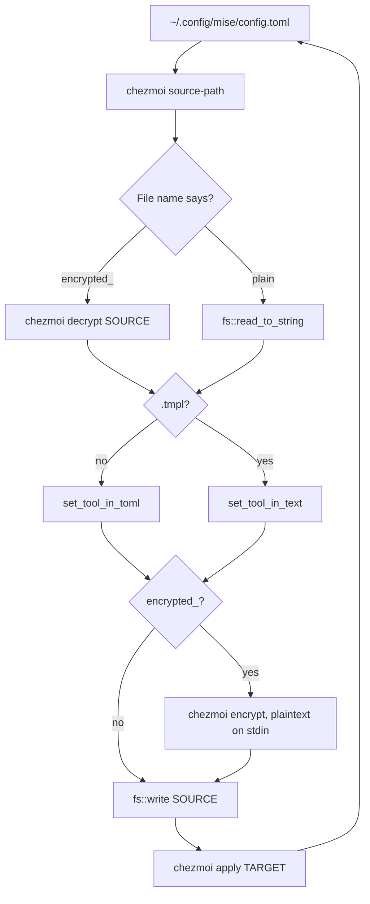

# belt, Part 3: `belt mise`, a TOML edit that leaves the rest of the file alone

`mise use --global node@22` is a one-line command that writes to `~/.config/mise/config.toml`. If chezmoi manages that file, the next `chezmoi status` prints `MM .config/mise/config.toml`: modified since chezmoi last wrote it, and about to be modified again. `chezmoi apply` then asks whether to put the old version back, and the honest answer is yes, because the source file in `~/.local/share/chezmoi` still says `node = "20"`. If the source is a template, mise's write went to the rendered output, which is the one file in the arrangement that nobody is supposed to edit. If the source is encrypted, mise never saw it at all.

The fix is to change the source and let chezmoi produce the target, which is what `chezmoi edit` does for a human with an editor. `belt mise add node@22` does the same for one key: it asks chezmoi where the source file is, reads that file through chezmoi's decryption when it has to, changes `tools.node` and nothing else, re-encrypts, writes, and applies. Without chezmoi in the picture it edits `~/.config/mise/config.toml` directly, which is the half of the job to build first.

"Nothing else" is the part that needs a different crate. Part 2's design note promised that `belt mise` would use `toml_edit`, not `toml`, because a serde writer rebuilds the whole file from a struct and your comments do not survive. This part shows the difference as a failing test, and then shows where even a format-preserving parser gives up: a file with `{{- if eq .chezmoi.os "darwin" }}` in it is not TOML, and the editor for that case is a loop over lines.

> [!RECALL]
> Before you continue: Part 2 put `#[serde(default)]` on all three config structs, not only on `Config`. If the attribute were on `Config` alone, what happens to a file that contains `[tag]` with no `words` key under it, and why?

By the end of this part, you'll have `belt mise add TOOL@VERSION`, a `[mise]` section in `config.toml` with one `chezmoi` switch, and a `src/mise.rs` that edits a plain file, an encrypted file, or an encrypted template through chezmoi's own commands. Eight new tests pin down the TOML edit and the line edit; the Checkpoint runs the whole thing against a throwaway chezmoi with a real age key.

## What you'll build

`belt mise add node@22` sets `tools.node = "22"` in mise's global config. On a file containing `node   = "20" # LTS`, the result is `node   = "22" # LTS`, spacing and comment intact. With `chezmoi = true` under `[mise]` in `~/.config/belt/config.toml`, the same command runs `chezmoi source-path`, reads the filename to learn whether it is encrypted or a template or both, edits accordingly, and finishes with `chezmoi apply` on that one target. The code is a new `src/mise.rs` of about 130 lines plus 67 lines of tests, a 10-line struct in `src/config.rs`, and about 20 lines of clap wiring in `src/main.rs`.

## Prerequisites

- Part 2 finished: `cargo test` reports six passing tests and `belt config init` writes a file.
- `chezmoi` 2.73.0 on your `PATH` for the chezmoi sections and for the Checkpoint. `mise use --global chezmoi@latest` or `brew install chezmoi` both work. The tests and the direct mode need neither chezmoi nor mise.
- No `age` binary is required. chezmoi has [built-in age encryption](https://www.chezmoi.io/user-guide/encryption/age/#builtin-age-encryption) that it uses when `age` is not on `PATH`; if `age` is installed, chezmoi calls it instead, and the output is the same armoured format.
- Nothing about Go templates beyond recognising `{{ ... }}` as one.

## Two crates called `toml`, and why this part uses the other one

The `toml` crate that `confy` pulled in during Part 2 does two things: parse text into a struct, and serialise a struct into text. Everything that is not a field of the struct, meaning comments, blank lines, the spaces around `=`, the order you wrote the keys in, is gone after the parse. For `belt config init`, which creates the file, that is fine. For a file the user has already annotated, it is destruction.

[`toml_edit`](https://docs.rs/toml_edit/0.25.17/toml_edit/) lives in the [same repository](https://github.com/toml-rs/toml) and parses the same files into a different thing: a **document**, which the crate describes as preserving _"comments, spaces and relative order of items"_. You index into it, assign a value, and call `to_string`, and the bytes you did not touch come back as they went in. The crate documents [two things it does not preserve](https://docs.rs/toml_edit/0.25.17/toml_edit/#limitations): the order of dotted keys, and a missing trailing newline. Neither matters here.

Add it, and add `etcetera` explicitly, because this part needs a directory that `confy` does not expose:

```bash
cargo add toml_edit etcetera@0.10.0
```

`Cargo.toml` gains `toml_edit = "0.25.17"` and `etcetera = "0.10.0"`. The `@0.10.0` is deliberate: `confy` depends on `etcetera 0.10.0`, and asking for the current 0.11.0 would put two copies of the crate in `Cargo.lock` for no benefit. `Cargo.lock` grows by `toml_edit`, a second `toml_datetime`, 1.1.2 next to the 0.7.5 that `toml 0.9` uses, and a second `winnow`, 1.0.4 next to 0.7.15. That is the two-versions situation from the first Part 2 exercise, and it builds fine: Cargo allows two versions of one crate in a build when they are not semver-compatible, and `toml 0.9` and `toml_edit 0.25` were released against different `winnow` majors.

> [!ASIDE]
> `toml_edit` is what `cargo add` itself uses to write your `Cargo.toml`. The command you ran a moment ago inserted two lines into a file full of your own formatting and left the rest alone; that was `toml_edit` at work.

## `tools.node = "22"` and not one byte more

Create `src/mise.rs` with the module header and the function that does the edit. The function takes text and returns text, so it needs no file and no chezmoi to test:

```rust
//! `belt mise`: edit mise's global `config.toml`, directly or through chezmoi.

use std::error::Error;
use std::ffi::OsStr;
use std::fs;
use std::io::{ErrorKind, Write};
use std::path::{Path, PathBuf};
use std::process::{Command, Stdio};

use etcetera::BaseStrategy;
use toml_edit::{DocumentMut, table, value};

use crate::config::MiseConfig;

/// Set `tools.<tool>` in a TOML document, keeping every other byte as it was.
pub fn set_tool_in_toml(text: &str, tool: &str, version: &str) -> Result<String, Box<dyn Error>> {
    let mut document: DocumentMut = text.parse()?;
    let tools = document
        .entry("tools")
        .or_insert(table())
        .as_table_like_mut()
        .ok_or("`tools` is not a table")?;
    tools.insert(tool, value(version));
    Ok(document.to_string())
}
```

Three names from `toml_edit` carry this. [`DocumentMut`](https://docs.rs/toml_edit/0.25.17/toml_edit/struct.DocumentMut.html) is the parsed, editable document; `text.parse()` works because the type implements `FromStr`, the same trait that lets `"42".parse::<u32>()` work. A document behaves as its root table, so [`entry("tools")`](https://docs.rs/toml_edit/0.25.17/toml_edit/struct.Table.html#method.entry) looks up the key and `or_insert(table())` creates an empty `[tools]` when there is none, in the same shape as `HashMap::entry`. [`as_table_like_mut`](https://docs.rs/toml_edit/0.25.17/toml_edit/enum.Item.html#method.as_table_like_mut) is the reason the function handles both ways of writing a table in TOML: a `[tools]` header and an inline `tools = { node = "20" }` are different types in the crate, `Table` and `InlineTable`, and `TableLike` is the trait they share. When `tools` exists and is neither, the `ok_or` turns the `None` into the error shown two paragraphs down.

Now the test that shows this version is wrong. Append to the bottom of the file:

```rust
#[cfg(test)]
mod tests {
    use super::*;

    #[test]
    fn toml_edit_keeps_comments_and_replaces_the_value() {
        let before = "# my tools\n[tools]\nnode   = \"20\" # LTS\npython = \"3.12\"\n";
        let after = set_tool_in_toml(before, "node", "22").unwrap();
        assert_eq!(
            after,
            "# my tools\n[tools]\nnode   = \"22\" # LTS\npython = \"3.12\"\n"
        );
    }
}
```

`cargo test` reports:

```text
assertion `left == right` failed
  left: "# my tools\n[tools]\nnode = \"22\"\npython = \"3.12\"\n"
 right: "# my tools\n[tools]\nnode   = \"22\" # LTS\npython = \"3.12\"\n"
```

The comment at the top survived and the `python` line survived, so the document did its job. The `node` line lost its three spaces and its `# LTS`. The reason is where `toml_edit` keeps that formatting. Every key and every value carries a [`Decor`](https://docs.rs/toml_edit/0.25.17/toml_edit/struct.Decor.html), the whitespace and comments before and after it, and `insert` builds a new key and a new value with default decor and drops the old pair. The fix is to change the value that is already there instead of replacing it. Replace the `tools.insert(tool, value(version));` line with a `match` on what the key holds:

```rust
    match tools.get_mut(tool) {
        // `node = { version = "20", postinstall = "..." }`: keep the options.
        Some(item) if item.is_table_like() => {
            let options = item.as_table_like_mut().expect("checked above");
            options.insert("version", value(version));
        }
        // `node   = "20" # LTS`: keep the spacing and the comment.
        Some(item) => {
            let existing = item
                .as_value_mut()
                .ok_or(format!("`tools.{tool}` is not a value"))?;
            let decor = existing.decor().clone();
            *existing = version.into();
            *existing.decor_mut() = decor;
        }
        None => {
            tools.insert(tool, value(version));
        }
    }
```

The middle arm is the one the test was about: take a copy of the [`decor`](https://docs.rs/toml_edit/0.25.17/toml_edit/enum.Value.html#method.decor), overwrite the value in place with `version.into()`, which turns a `&str` into a `toml_edit::Value` string, and put the decor back. The key is never touched, so `node   =` keeps its spaces. The first arm exists because mise's `[tools]` entries are not always strings. [Tool options](https://mise.jdx.dev/dev-tools/#tool-options) are written as `node = { version = "20", postinstall = "corepack enable" }`, and a version bump must not delete the `postinstall`. `is_table_like` and then `as_table_like_mut` with `expect` is the `if let` you cannot write in a match guard; the `expect` message says what was checked. The third arm is the original line, now only reached when the key is new, where default decor is the right decor.

Now the input that almost fits. `tools = "nope"` is valid TOML with `tools` as a string, so `as_table_like_mut` returns `None` and the function fails with `` `tools` is not a table``. An array of tables, `[[tools.node]]`, makes `tools.node` an item that is neither table-like nor a value, and the second arm's `ok_or` reports `` `tools.node` is not a value``. A version written as an array, `node = ["20", "22"]`, is a value, so the second arm replaces it with the string `"22"` and keeps its decor. mise [installs every version in a list](https://mise.jdx.dev/dev-tools/versions.html#multiple-versions), so `belt` has turned two installs into one, and prints nothing about it. This loss is a known limit, and the exercises come back to it. A file that is not TOML at all fails in `parse` with `toml_edit`'s own diagnostic, and the next section shows what that looks like.

Three more tests belong next to the first one. Add them inside `mod tests`:

```rust
    #[test]
    fn toml_edit_creates_the_tools_table_when_missing() {
        let after = set_tool_in_toml("[env]\nFOO = \"bar\"\n", "node", "22").unwrap();
        assert_eq!(after, "[env]\nFOO = \"bar\"\n\n[tools]\nnode = \"22\"\n");
    }

    #[test]
    fn toml_edit_keeps_tool_options() {
        let before = "[tools]\nnode = { version = \"20\", postinstall = \"corepack enable\" }\n";
        let after = set_tool_in_toml(before, "node", "22").unwrap();
        assert_eq!(
            after,
            "[tools]\nnode = { version = \"22\", postinstall = \"corepack enable\" }\n"
        );
    }
```

The first of these records a choice `toml_edit` made for you: `or_insert(table())` appends the new table at the end of the document, header and all, after a blank line. The third test is yours: `toml_edit_rejects_a_tools_value_that_is_not_a_table`. Pass `"tools = \"nope\"\n"`, keep the error with `unwrap_err` as the Part 2 test did, and `assert_eq!` its `to_string()` against the exact message above, backticks included. Then move on to the file.

## Where mise keeps the file, and the direct edit

mise reads its global config from [`~/.config/mise`](https://mise.jdx.dev/configuration.html#global-config), the directory it calls `MISE_CONFIG_DIR`, in a filenamed `config.toml`. That is the XDG config directory plus `mise`, where XDG is the freedesktop.org base-directory layout from Part 2, and the XDG part is why `etcetera` is a direct dependency. `confy` only hands out paths under `~/.config/belt`; for `~/.config/mise`, `belt` needs the parent directory. Add these two functions above `set_tool_in_toml`:

```rust
/// Where mise reads its global configuration: `~/.config/mise/config.toml`.
pub fn global_config_path() -> Result<PathBuf, Box<dyn Error>> {
    Ok(etcetera::choose_base_strategy()?
        .config_dir()
        .join("mise/config.toml"))
}

/// Split `node@22` into `("node", "22")`.
pub fn parse_tool_spec(spec: &str) -> Result<(&str, &str), Box<dyn Error>> {
    match spec.split_once('@') {
        Some((tool, version)) if !tool.is_empty() && !version.is_empty() => Ok((tool, version)),
        _ => Err(format!("expected TOOL@VERSION, for example node@22, got {spec:?}").into()),
    }
}
```

[`choose_base_strategy`](https://docs.rs/etcetera/0.10.0/etcetera/base_strategy/fn.choose_base_strategy.html) is the directory-level cousin of the `choose_app_strategy` that `confy` calls; on Linux and macOS it returns the XDG strategy, whose `config_dir` is `$XDG_CONFIG_HOME` or `~/.config`, the same rule Part 2 traced through the spec. The `use etcetera::BaseStrategy;` at the top of the file is what makes `.config_dir()` callable: it is a trait method, and Rust only sees trait methods when the trait is in scope.

`parse_tool_spec` returns two borrowed halves of its input, `(&str, &str)`, and the compiler ties their lifetime to `spec` without being told. The guard rejects `node`, `node@` and `@22`; `node@22@x` splits at the first `@` and yields the version `22@x`, which mise will reject later with its own message. `{spec:?}` prints the input with quotes, so an empty-looking argument is visible in the error.

Now the command itself, in two halves. The direct half is this section; the chezmoi half is the next one. Add below `parse_tool_spec`:

```rust
/// Set `tools.<tool> = "<version>"` in mise's global config and make it live.
pub fn add_tool(config: &MiseConfig, tool: &str, version: &str) -> Result<(), Box<dyn Error>> {
    let target = global_config_path()?;
    if config.chezmoi {
        return add_tool_via_chezmoi(&target, tool, version);
    }
    let before = match fs::read_to_string(&target) {
        Ok(text) => text,
        Err(err) if err.kind() == ErrorKind::NotFound => String::new(),
        Err(err) => return Err(format!("could not read {}: {err}", target.display()).into()),
    };
    let after = set_tool_in_toml(&before, tool, version)
        .map_err(|err| format!("could not edit {}: {err}", target.display()))?;
    if let Some(parent) = target.parent() {
        fs::create_dir_all(parent)?;
    }
    fs::write(&target, after)?;
    println!("wrote {}", target.display());
    Ok(())
}
```

A missing file is an empty document, so the first `belt mise add` on a fresh machine creates `~/.config/mise/config.toml` containing `[tools]` and one key. Every other read error is reported with the path. The `map_err` on the edit is the same move as Part 2's `load`: `toml_edit`'s parse error already carries a line, a column and a caret, and the path is the one thing it cannot know.

`MiseConfig` is yours to write in `src/config.rs`. It has `DecentConfig` as its template: one field, `pub chezmoi: bool`, the same four derives plus `Default`, the same `#[serde(default, deny_unknown_fields)]`, and a doc comment that says what the switch does. Add `pub mise: MiseConfig,` as the third field of `Config`. Because `bool` defaults to `false`, a `config.toml` written by Part 2's `belt config init` keeps working unchanged, and `belt config init` from now on writes an empty `[mise]` header the way it writes `[decent]`.

The command-line wiring, which is clap's job, goes in `src/main.rs`: `mod mise;` after `mod config;`, a `Mise` variant on `Command` with a `MiseAction` subcommand enum, in the shape `Config` and `ConfigAction` already have:

```rust
    /// Edit mise's global configuration.
    Mise {
        #[command(subcommand)]
        action: MiseAction,
    },
}

#[derive(Subcommand)]
enum MiseAction {
    /// Set a tool version in `[tools]`, for example `node@22`.
    Add {
        #[arg(value_name = "TOOL@VERSION")]
        spec: String,
    },
}
```

and one arm at the end of the `match` in `run`:

```rust
        Command::Mise {
            action: MiseAction::Add { spec },
        } => {
            let config = Config::load(&config_path)?;
            let (tool, version) = mise::parse_tool_spec(&spec)?;
            mise::add_tool(&config.mise, tool, version)?;
        }
```

`value_name = "TOOL@VERSION"` is cosmetic and worth the line: `belt mise add --help` now prints `Usage: belt mise add [OPTIONS] <TOOL@VERSION>` instead of `<SPEC>`. At this point the build fails with `cannot find function 'add_tool_via_chezmoi'`, which is the next section.

## chezmoi's idea of the file

chezmoi keeps a **source state**, a directory of files under `~/.local/share/chezmoi` by default, and computes a **target state** from it, the files it writes into your home directory. Three facts about the source state make `belt`'s job tractable, and all three are in the [source state attributes](https://www.chezmoi.io/reference/source-state-attributes/) reference:

1. The target `~/.config/mise/config.toml` is stored under a name like `dot_config/mise/config.toml`, and chezmoi spells the attributes that change how it handles the file into that filename as prefixes and suffixes. `encrypted_` at the front means the bytes on disk are ciphertext. `.tmpl` at the end means the plaintext is a template.
2. The order is fixed. For a regular file the prefixes come in the order `encrypted_`, `private_`, `readonly_`, `empty_`, `executable_`, `dot_`, so `encrypted_` is always first when it is present at all.
3. Encrypted files additionally end in `.age` or `.asc`, which chezmoi strips before it reads the other attributes. An encrypted template is therefore `encrypted_config.toml.tmpl.age`: template suffix first, encryption suffix last. The Checkpoint prints exactly that name.

The commands `belt` needs are four, each one documented as doing one thing. [`source-path`](https://www.chezmoi.io/reference/commands/source-path/) prints the source file for a target, or `not managed` on stderr with exit status 1 when chezmoi does not know the file. [`decrypt`](https://www.chezmoi.io/reference/commands/decrypt/) and [`encrypt`](https://www.chezmoi.io/reference/commands/encrypt/) take a file, or standard input when given none, and write the result to standard output. [`apply`](https://www.chezmoi.io/reference/commands/apply/) accepts a single target path. Put together:



The code follows the diagram box for box. Add it below `add_tool`:

```rust
/// Edit the file chezmoi owns for `target`, then `chezmoi apply` it.
fn add_tool_via_chezmoi(target: &Path, tool: &str, version: &str) -> Result<(), Box<dyn Error>> {
    let source_path = chezmoi(&[OsStr::new("source-path"), target.as_os_str()], b"")?;
    let source = PathBuf::from(String::from_utf8(source_path)?.trim_end());
    let attributes = SourceAttributes::of(&source);

    let before = if attributes.encrypted {
        String::from_utf8(chezmoi(&[OsStr::new("decrypt"), source.as_os_str()], b"")?)?
    } else {
        fs::read_to_string(&source)?
    };
    let after = if attributes.template {
        set_tool_in_text(&before, tool, version)
    } else {
        set_tool_in_toml(&before, tool, version)
            .map_err(|err| format!("could not edit {}: {err}", source.display()))?
    };
    let bytes = if attributes.encrypted {
        chezmoi(&[OsStr::new("encrypt")], after.as_bytes())?
    } else {
        after.into_bytes()
    };
    fs::write(&source, bytes)?;
    println!("wrote {}", source.display());

    let status = Command::new("chezmoi").arg("apply").arg(target).status()?;
    if !status.success() {
        return Err(format!("chezmoi apply exited with {status}").into());
    }
    Ok(())
}

/// What chezmoi's source filename says about the file.
struct SourceAttributes {
    /// `encrypted_` prefix: the bytes on disk are ciphertext.
    encrypted: bool,
    /// `.tmpl` suffix: the plaintext is a Go template, not plain TOML.
    template: bool,
}

impl SourceAttributes {
    fn of(source: &Path) -> Self {
        let name = source
            .file_name()
            .and_then(OsStr::to_str)
            .unwrap_or_default();
        // chezmoi appends .age or .asc after every other attribute.
        let name = name
            .strip_suffix(".age")
            .or_else(|| name.strip_suffix(".asc"))
            .unwrap_or(name);
        Self {
            encrypted: name.starts_with("encrypted_"),
            template: name.ends_with(".tmpl"),
        }
    }
}
```

`encrypt` is fed the plaintext on standard input instead of through a temporary file, so the decrypted content never touches the disk in this process; `chezmoi edit` [decrypts to a private temporary directory](https://www.chezmoi.io/reference/commands/edit/) because an editor needs a file, and `belt` does not. `source.as_os_str()` instead of a `&str` is why the helper below takes `&[&OsStr]`: a path on Unix is bytes, not necessarily UTF-8, and `Command` accepts it as it is. The function reads the `source-path` output as `String`, by contrast, because it needs `trim_end` to drop the trailing newline and `String` has one.

The code runs `apply` differently from the other three, and on purpose. The helper that follows captures standard output and error so that `belt` can report `chezmoi exit status: 1: chezmoi: /Users/you/.config/mise/config.toml: not managed` in one line. `apply` instead inherits your terminal, because when the target was [modified since chezmoi last wrote it](https://www.chezmoi.io/reference/commands/apply/), chezmoi asks `has changed since chezmoi last wrote it?` and waits for a key. With its input redirected it cannot, and fails with `could not open a new TTY`. Inheriting the terminal gives the user the prompt chezmoi meant them to see.

> [!HEADS-UP]
> That prompt is exactly the `mise use --global` situation from the opening. If you ran it before switching to `belt`, the first `belt mise add` will stop at chezmoi's question. Answer it once; after that, `belt` only ever writes the source, and the target stays in step.

The helper:

```rust
/// Run `chezmoi` with `args`, feed it `stdin`, and return its stdout.
fn chezmoi(args: &[&OsStr], stdin: &[u8]) -> Result<Vec<u8>, Box<dyn Error>> {
    let mut child = Command::new("chezmoi")
        .args(args)
        .stdin(Stdio::piped())
        .stdout(Stdio::piped())
        .stderr(Stdio::piped())
        .spawn()
        .map_err(|err| format!("could not run chezmoi: {err}"))?;
    child
        .stdin
        .take()
        .expect("stdin was piped")
        .write_all(stdin)?;
    let output = child.wait_with_output()?;
    if !output.status.success() {
        let stderr = String::from_utf8_lossy(&output.stderr);
        return Err(format!("chezmoi {}: {}", output.status, stderr.trim()).into());
    }
    Ok(output.stdout)
}
```

[`Stdio::piped()`](https://doc.rust-lang.org/std/process/struct.Stdio.html#method.piped) on all three streams means `belt` owns them. `child.stdin.take()` moves the write end out of the `Child` so that it is dropped, and so closed, as soon as `write_all` returns; without that close, `chezmoi encrypt` would wait for more input forever. [`wait_with_output`](https://doc.rust-lang.org/std/process/struct.Child.html#method.wait_with_output) then drains the other two streams and waits for exit. The `map_err` on `spawn` turns the bare `No such file or directory (os error 2)` into `could not run chezmoi: ...`, which is the message a user without chezmoi installed meets.

> [!DESIGN-NOTE]
> **Why not `chezmoi edit` with `belt` as the editor?**
>
> `chezmoi edit` already does the decrypt, edit, re-encrypt dance, and it chooses its editor from [`edit.command` in the chezmoi config, then `$VISUAL`, then `$EDITOR`](https://www.chezmoi.io/reference/configuration-file/variables/). Setting `EDITOR=belt mise edit-file` before calling `chezmoi edit ~/.config/mise/config.toml` would let chezmoi do everything in this section.
>
> Three things argue against it. A user who has set `edit.command` wins over the environment, so the trick silently opens their editor instead. `belt` would need a hidden subcommand whose only purpose is to be called back, and a path to it that survives a shell-style split. And `chezmoi edit` applies only when told to with `--apply`, where `mise use` makes the new version live immediately; matching mise is the behaviour a `mise` subcommand should have. Three `Command` calls and one `status()` are less machinery than that.
>
> There is one thing `chezmoi edit` and `belt` both leave undone: the source directory is usually a git repository, and nothing here commits. `chezmoi git -- commit -am 'node 22'` after the fact, or `git.autoCommit = true` in the chezmoi config, are the two ways to close that gap, and one of the exercises is the first of them.

## A template is not TOML

Here is what happens when the file chezmoi hands back contains template code and `belt` parses it as TOML anyway. The error is `toml_edit`'s, with the path prepended by `map_err`:

```text
error: could not edit /tmp/belt-part3/home/.config/mise/config.toml: TOML parse error at line 3, column 1
  |
3 | {{- if eq .chezmoi.os "darwin" }}
  | ^
invalid key-value pair, expected key
```

A line that starts with `{{` is not a key, and no TOML parser can be talked into thinking otherwise. Rendering the template first is not an answer either, because the thing to edit is the template, not its output; rendering it would produce the same file `mise use` wrote, with the branches for the other operating systems gone. The only edit that respects a template it does not understand is a textual one, and TOML's own rules make a textual edit safe enough as long as it stays inside the right section. Appending `[tools]` to the end of a file that already has one is not an option: the specification says [a table cannot be defined more than once](https://toml.io/en/v1.0.0#table), and mise would refuse the file. So the editor finds the existing header, and only appends a new one when there is none:

```rust
/// A template is not TOML to a parser, so edit it line by line: replace the
/// key inside `[tools]`, insert it under the header, or append the table.
///
/// shortcut: edits the first `[tools]` header only and does not see dotted
/// keys or inline tables; upgrade to a template-aware pass if a file needs it.
pub fn set_tool_in_text(text: &str, tool: &str, version: &str) -> String {
    let assignment = format!("{tool} = \"{version}\"");
    let mut lines: Vec<&str> = text.lines().collect();

    let Some(header) = lines.iter().position(|line| line.trim() == "[tools]") else {
        let mut edited = text.to_string();
        if !edited.is_empty() && !edited.ends_with('\n') {
            edited.push('\n');
        }
        edited.push_str(&format!("\n[tools]\n{assignment}\n"));
        return edited;
    };

    let section_end = lines[header + 1..]
        .iter()
        .position(|line| line.trim_start().starts_with('['))
        .map_or(lines.len(), |offset| header + 1 + offset);
    let existing = lines[header + 1..section_end]
        .iter()
        .position(|line| {
            line.split_once('=')
                .is_some_and(|(key, _)| key.trim() == tool)
        })
        .map(|offset| header + 1 + offset);

    match existing {
        Some(index) => lines[index] = &assignment,
        None => lines.insert(header + 1, &assignment),
    }
    let mut edited = lines.join("\n");
    edited.push('\n');
    edited
}
```

`let Some(header) = ... else { ... }` is a **let-else**: bind the value if the pattern matches, otherwise run the block, which must leave the function. It replaces a `match` whose other arm would have been four lines of early return. The section runs from the line after the header to the next line that starts with `[`, which is the next header; `section_end` falls back to the end of the file when there is no next header. Inside the section, a line belongs to the tool when the text before its first `=` trims to the tool name, so `# node = "20"` does not match and `node = "20"` does. The editor replaces a match in place; no match means the assignment goes directly under the header, where a reader sees it first. `text.lines()` discards the final newline, which is why the function puts one back.

The doc comment states the limits, and the word `shortcut` in it is deliberate so that a search finds them later. If `[tools]` appears twice, once per template branch, the editor edits only the first. If the header is inside a `{{- if }}` block, so is the new key. This editor does not parse values, so it replaces a tool written as an inline table on one line with a string, options and all. Dotted keys at the top of the file, `tools.node = "20"`, are invisible to it. The chezmoi-managed mise config this part was written against has `[tools]` once, outside any conditional, with `{{- if }}` blocks nested below it, and that is the shape the tests use:

```rust
    const TEMPLATE: &str = "[settings]\nexperimental = true\n\n[tools]\nnode = \"20\"\n{{- if eq .chezmoi.os \"darwin\" }}\nxcodes = \"latest\"\n{{- end }}\n\n[env]\nFOO = \"bar\"\n";

    #[test]
    fn text_edit_replaces_inside_the_tools_section_only() {
        let after = set_tool_in_text(TEMPLATE, "node", "22");
        assert_eq!(after, TEMPLATE.replace("node = \"20\"", "node = \"22\""));
    }

    #[test]
    fn text_edit_inserts_under_the_header() {
        let after = set_tool_in_text(TEMPLATE, "python", "3.12");
        assert_eq!(
            after,
            TEMPLATE.replace("[tools]\n", "[tools]\npython = \"3.12\"\n")
        );
    }

    #[test]
    fn text_edit_appends_the_table_when_missing() {
        let after = set_tool_in_text("[env]\nFOO = \"bar\"", "node", "22");
        assert_eq!(after, "[env]\nFOO = \"bar\"\n\n[tools]\nnode = \"22\"\n");
    }
```

The expected values are written as edits to `TEMPLATE` instead of as second literals, so that the test says what changed and nothing else. The third test feeds a file with no trailing newline, the one case the first branch has to repair before appending. One more test is yours, and it is the smallest in the file: `tool_spec_needs_both_halves`, which asserts that `parse_tool_spec("node@22")` unwraps to `("node", "22")` and that `node`, `node@` and `@22` are all errors. Write it, then run the Checkpoint.

One more thing about the choice between the two editors: `belt` makes it from the filename, not by trying `toml_edit` first and falling back on failure. A plain file with a typo in it would fail the parser, get the line editor, and have a key appended to a broken file before `chezmoi apply` ran. The filename is chezmoi's statement of intent; the parser's verdict is not.

## Checkpoint

> [!PREDICT]
> After the last `belt mise add` below, two files hold the result: the source `encrypted_config.toml.age` and the target `config.toml`. Which of them contains the bytes `python = "3.12"`, and what does the other one start with?

**Run this to verify your work so far:**

```bash
cargo fmt --all -- --check
cargo clippy --locked --all-targets --all-features -- -D warnings
cargo test --locked --all-features
cargo build --quiet
BELT=$PWD/target/debug/belt
export HOME=/tmp/belt-part3/home
mkdir -p $HOME/.config/chezmoi $HOME/.config/mise $HOME/.config/belt
printf '# pinned by hand\n[tools]\nnode   = "20" # LTS\n' > $HOME/.config/mise/config.toml
$BELT mise add node@22
cat $HOME/.config/mise/config.toml
chezmoi age-keygen --output=$HOME/key.txt
printf 'encryption = "age"\n[age]\n    identity = "%s/key.txt"\n    recipient = "%s"\n' "$HOME" "$(grep -o 'age1[a-z0-9]*' $HOME/key.txt)" > $HOME/.config/chezmoi/chezmoi.toml
chezmoi add --encrypt $HOME/.config/mise/config.toml
chezmoi source-path $HOME/.config/mise/config.toml
printf '[mise]\nchezmoi = true\n' > $HOME/.config/belt/config.toml
$BELT mise add python@3.12
chezmoi cat $HOME/.config/mise/config.toml
chezmoi status
head -c 40 $(chezmoi source-path $HOME/.config/mise/config.toml); echo
```

The `export HOME` line is what makes this safe to run on your real machine: chezmoi, `etcetera` and `confy` all derive their directories from `HOME`, so everything below it lands in `/tmp/belt-part3/home` and your own dotfiles are never read. Build first and keep using `$BELT`, because once `HOME` has moved, `cargo` would look for its toolchain under the new one and fail. `chezmoi age-keygen --output` writes the identity to the file and prints nothing; the recipient is on the `# public key:` line inside it, which the `grep` extracts.

Expected output, trimmed of the `Compiling` lines:

```text
running 14 tests
test config::tests::defaults_round_trip_through_disk ... ok
test config::tests::missing_file_means_defaults_and_no_write ... ok
test config::tests::too_many_words_is_rejected ... ok
test mise::tests::text_edit_appends_the_table_when_missing ... ok
test mise::tests::text_edit_inserts_under_the_header ... ok
test mise::tests::text_edit_replaces_inside_the_tools_section_only ... ok
test mise::tests::toml_edit_creates_the_tools_table_when_missing ... ok
test mise::tests::toml_edit_keeps_comments_and_replaces_the_value ... ok
test mise::tests::toml_edit_keeps_tool_options ... ok
test mise::tests::toml_edit_rejects_a_tools_value_that_is_not_a_table ... ok
test mise::tests::tool_spec_needs_both_halves ... ok
test tag::tests::empty_input_still_gets_a_tag ... ok
test tag::tests::hello_world_has_a_known_tag ... ok
test tag::tests::one_byte_changes_the_tag ... ok

test result: ok. 14 passed; 0 failed; 0 ignored; 0 measured; 0 filtered out; finished in 0.00s
wrote /tmp/belt-part3/home/.config/mise/config.toml
# pinned by hand
[tools]
node   = "22" # LTS
/tmp/belt-part3/home/.local/share/chezmoi/dot_config/mise/encrypted_config.toml.age
wrote /tmp/belt-part3/home/.local/share/chezmoi/dot_config/mise/encrypted_config.toml.age
# pinned by hand
[tools]
node   = "22" # LTS
python = "3.12"
-----BEGIN AGE ENCRYPTED FILE-----
YWdlL
```

The test lines may come out in a different order. The first `wrote` is the direct edit: `node   = "22" # LTS` with its spacing and comment. After `chezmoi add --encrypt`, the source filename carries both `encrypted_` and `.age`, and the second `wrote` names that file; `belt` decrypted it, appended `python` at the end of `[tools]`, re-encrypted and applied. `chezmoi cat` renders the target state and shows the new key; `chezmoi status` prints nothing, which means the target on disk matches the source. The last line is the first 40 bytes of the source: ciphertext, which answers the prediction. The plaintext exists only in the target and, briefly, in `belt`'s memory.

To see the template path as well, run `chezmoi chattr +template $HOME/.config/mise/config.toml`, then `chezmoi source-path` again: the name becomes `encrypted_config.toml.tmpl.age`, and the next `belt mise add` goes through `set_tool_in_text`. `rm -r /tmp/belt-part3` when you are done, and open a new shell instead of trying to put `HOME` back.

**Likely errors:**

- If you see `error[E0004]: non-exhaustive patterns: Command::Mise { .. } not covered`, the `Mise` arm is missing from the `match` in `run`.
- If you see `error[E0432]: unresolved import 'etcetera'`, run the `cargo add` line from the first section; `confy` depends on `etcetera`, but that does not make the crate visible to your code.
- If you see `error[E0599]: no method named 'config_dir' found for struct 'etcetera::base_strategy::Xdg'`, the `use etcetera::BaseStrategy;` line is missing. The method exists, but the trait that provides it is not in scope.
- If the first test fails with `left: "# my tools\n[tools]\nnode = \"22\"\n...`, `set_tool_in_toml` is still calling `insert` on an existing key. Apply the three-arm `match`.
- If `belt mise add` says `error: could not run chezmoi: No such file or directory (os error 2)`, chezmoi is not on your `PATH`; the direct mode and the tests still work.
- If it says `error: chezmoi exit status: 1: chezmoi: /tmp/belt-part3/home/.config/mise/config.toml: not managed`, the `chezmoi add --encrypt` line was skipped, or one of the commands ran with a different `HOME` than the others.
- If `chezmoi add` fails with `age: error: missing recipients`, the `recipient` line in `chezmoi.toml` is empty; check that `grep -o 'age1[a-z0-9]*' $HOME/key.txt` prints a key.
- If `belt mise add` stops at `has changed since chezmoi last wrote it?`, the target was edited behind chezmoi's back, by hand or by `mise use`. Answer the prompt; in a script with no terminal the same situation fails with `could not open a new TTY`.
- If `chezmoi cat` shows the new key but `cat $HOME/.config/mise/config.toml` does not, the `apply` call is missing or returned non-zero; `belt` reports the latter as `chezmoi apply exited with ...`.

## What's next

Every function in `src/mise.rs` returns `Box<dyn Error>`, and the `chezmoi` helper alone has three distinct ways to fail: the binary is missing, the command exited non-zero, the output was not UTF-8. The next part replaces that with a `BeltError` enum, one variant per failure, `Display` written once, and the `describe` loop from Part 2 deleted because the error carries its own context. The same part fills in the random-tag arm of `belt tag` with the `rand` crate, which was promised two parts ago. Both are overdue because `belt mise` was the more interesting problem, and it is the module with the most error paths, so it is the right place to start.

Before you try the exercises: in two sentences, explain to a sceptical colleague why `belt` chooses between the TOML editor and the line editor from the source filename instead of by trying `toml_edit` first. Your answer should name what goes wrong on a plain file with a syntax error.

## Exercises

- [ ] Add `belt mise remove TOOL`. In the TOML path, `TableLike::remove` deletes the key and the decor goes with it; check whether a trailing comment on the removed line survives, and whether a now-empty `[tools]` header should be removed too. In the text path, delete the matching line.
- [ ] mise reads `MISE_CONFIG_DIR` and `MISE_GLOBAL_CONFIG_FILE` before it falls back to `~/.config/mise/config.toml`. Make `global_config_path` honour both, in [the order mise documents](https://mise.jdx.dev/configuration.html#global-config), and add a test that sets each variable with `std::env::set_var` inside an `unsafe` block, which is what edition 2024 requires.
- [ ] After `fs::write` in `add_tool_via_chezmoi`, run `chezmoi git -- add` and `chezmoi git -- commit -m "mise: node 22"` so the source repository records the change. Decide what `belt` should do when the source directory is not a git repository, and make the test for that decision the first thing you write.
- [ ] The array case: `belt` replaces `node = ["20", "22"]` with a string without a word. Make `set_tool_in_toml` refuse an array with an error that quotes the current value, then decide whether `belt mise add` should take a flag to append to the array instead.
- [ ] Verify before you write. In the template path, after `set_tool_in_text` and before `fs::write`, ask chezmoi to render the edited template with `chezmoi execute-template` on the new text, parse the rendering with `toml_edit`, and fail with the parser's diagnostic if it does not parse. Measure how much slower `belt mise add` becomes.

## Sources

Primary documentation:

1. [chezmoi: source state attributes](https://www.chezmoi.io/reference/source-state-attributes/) — the prefix and suffix tables, the fixed prefix order with `encrypted_` first, and the `.age` and `.asc` suffixes that are stripped before the others are read.
2. [chezmoi: `source-path`](https://www.chezmoi.io/reference/commands/source-path/), [`decrypt`](https://www.chezmoi.io/reference/commands/decrypt/), [`encrypt`](https://www.chezmoi.io/reference/commands/encrypt/) and [`apply`](https://www.chezmoi.io/reference/commands/apply/) — the four commands `belt` runs; `decrypt` and `encrypt` read standard input when given no file and write standard output; `apply` prompts when a target has changed since chezmoi last wrote it.
3. [chezmoi: `edit`](https://www.chezmoi.io/reference/commands/edit/) and [configuration variables](https://www.chezmoi.io/reference/configuration-file/variables/) — decrypts to a private temporary directory and re-encrypts afterwards; `--apply` is opt-in; `edit.command`, `$VISUAL`, `$EDITOR`; the alternative the design note rejects.
4. [chezmoi: `status`](https://www.chezmoi.io/reference/commands/status/) — the two-column format and what `MM` means.
5. [chezmoi: encryption](https://www.chezmoi.io/user-guide/encryption/) and [age](https://www.chezmoi.io/user-guide/encryption/age/) — ASCII-armoured storage with the `encrypted_` attribute, the `encryption = "age"` configuration, and the built-in age implementation used when no `age` binary is on `PATH`.
6. [mise: global and system config](https://mise.jdx.dev/configuration.html#global-config) — `~/.config/mise` as `MISE_CONFIG_DIR`, `config.toml`, the fact that `mise use --global` writes to it, and the list form of a tool version.
7. [mise: `use`](https://mise.jdx.dev/cli/use.html) — `--global` writes the global config file, falling back to `~/.config/mise/config.toml`; [mise: multiple versions](https://mise.jdx.dev/dev-tools/versions.html#multiple-versions) — every version in a list is installed and the first provides the command.
8. [mise: tool options](https://mise.jdx.dev/dev-tools/#tool-options) — the `{ version = "...", postinstall = "..." }` form that the first `match` arm preserves.
9. [`toml_edit` crate docs](https://docs.rs/toml_edit/0.25.17/toml_edit/) — "comments, spaces and relative order" preserved; the two documented limitations.
10. [`toml_edit::Table::entry`](https://docs.rs/toml_edit/0.25.17/toml_edit/struct.Table.html#method.entry), [`Item::as_table_like_mut`](https://docs.rs/toml_edit/0.25.17/toml_edit/enum.Item.html#method.as_table_like_mut), [`Value::decor`](https://docs.rs/toml_edit/0.25.17/toml_edit/enum.Value.html#method.decor) and [`Decor`](https://docs.rs/toml_edit/0.25.17/toml_edit/struct.Decor.html) — the API the edit is built from, and where the whitespace and comments live.
11. [`etcetera::choose_base_strategy`](https://docs.rs/etcetera/0.10.0/etcetera/base_strategy/fn.choose_base_strategy.html) — the directory-level strategy; XDG on Linux and macOS.
12. [`std::process::Stdio::piped`](https://doc.rust-lang.org/std/process/struct.Stdio.html#method.piped) and [`Child::wait_with_output`](https://doc.rust-lang.org/std/process/struct.Child.html#method.wait_with_output) — owning a child's streams and draining them.

Specifications:

13. [TOML v1.0.0: Table](https://toml.io/en/v1.0.0#table) — "you cannot define a table more than once".
14. [toml-rs repository](https://github.com/toml-rs/toml) — `toml` and `toml_edit` share a repository and a parser lineage, which is why the diagnostics look alike.
